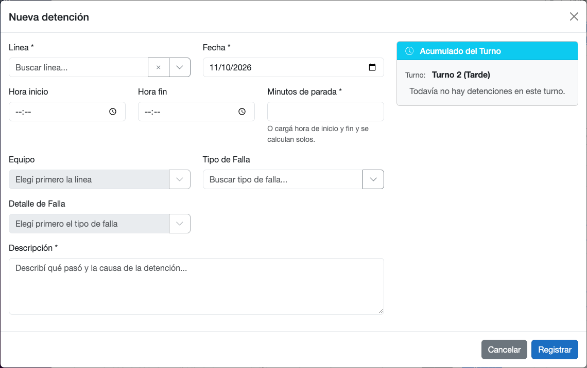
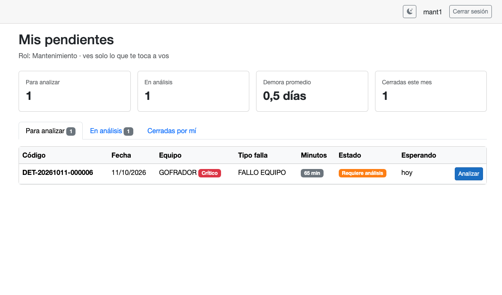
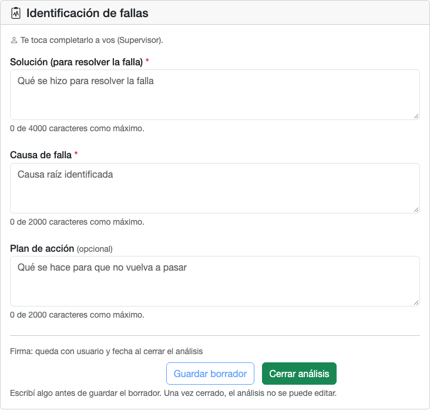
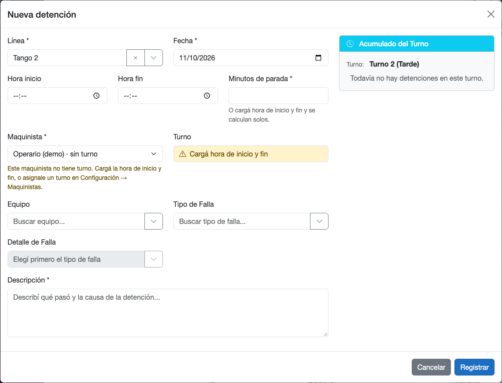
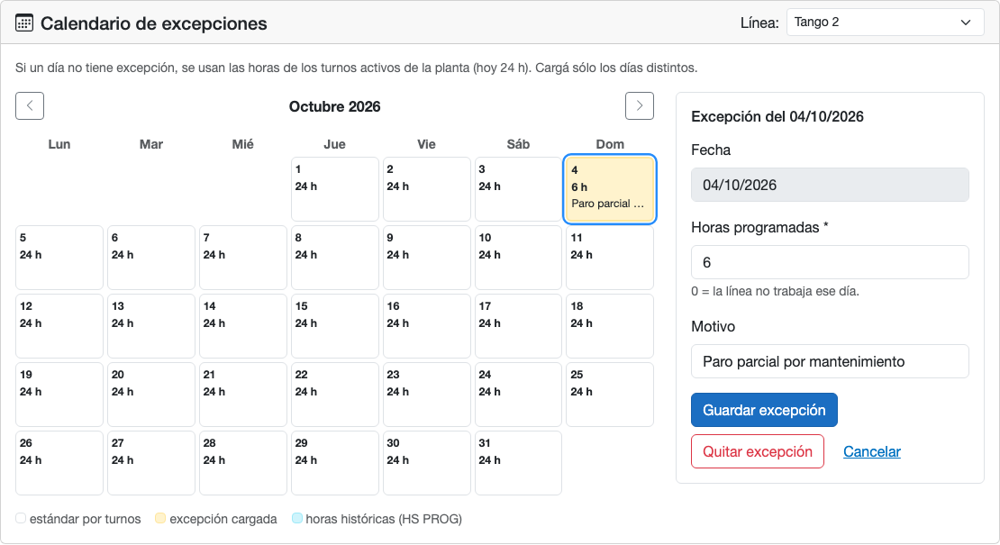
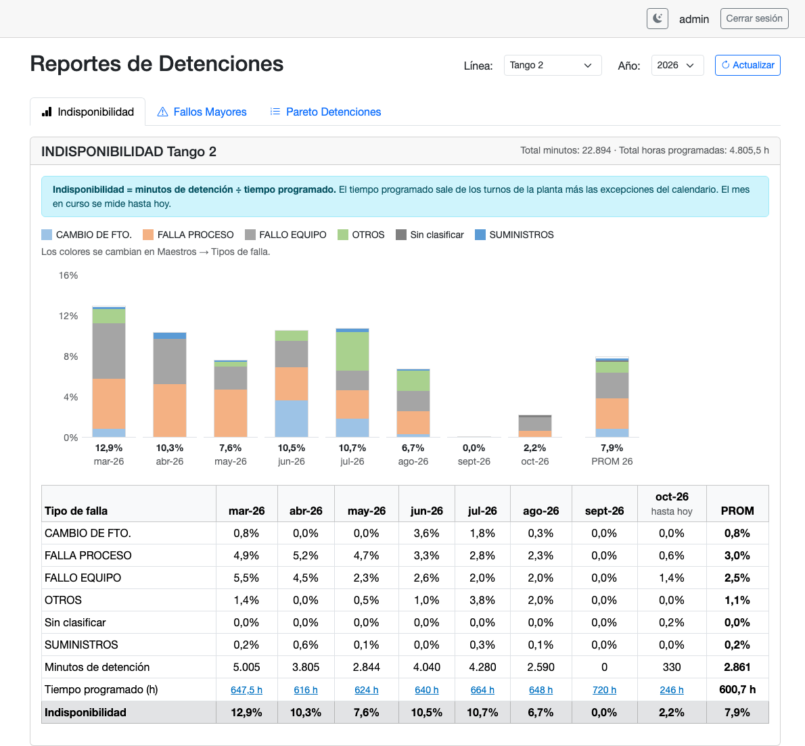

# Guía de uso · Detenciones y análisis de fallas

Para operarios, mantenimiento, supervisores y el administrador. Se lee en 5 minutos.

## Qué cambió

- Al cargar una detención podés poner **hora de inicio y hora de fin**: los minutos y el turno se calculan solos.
- Las paradas largas de ciertos tipos de falla **piden un análisis**. Le llegan a quien corresponde en **Mis pendientes**.
- El análisis se completa en la misma detención: **Solución**, **Causa de falla** y **Plan de acción**.
- **Base de soluciones**: buscás cómo se resolvió antes una falla parecida.
- Los reportes calculan la indisponibilidad con las **horas programadas reales** de cada día.
- Cuando algo no se puede hacer, la pantalla te dice **por qué y qué hacer**. Si igual te trabás, mirá la tabla [Si no te aparece…](#si-no-te-aparece).

## Paso a paso por rol

### Operario: cargar una parada

1. Menú **Detenciones → Ver detenciones** y tocá **Nueva detención**.
2. Elegí la **Línea**. Hasta que no la elijas, **Equipo** queda gris.
3. Cargá **Hora inicio** y **Hora fin**. Si no las sabés, escribí los **Minutos de parada**.
4. Elegí **Equipo** y **Tipo de Falla**. Después se habilita **Detalle de Falla**.
5. Escribí la **Descripción**: qué pasó y por qué.
6. Si aparece el cartel amarillo **"Esta detención va a requerir análisis"**, está bien: le llega a Mantenimiento o al Supervisor.
7. Tocá **Registrar**.

### Mantenimiento: analizar y cerrar

1. Menú **Detenciones → Mis pendientes**. El número rojo al lado indica cuántas fallas te esperan.
2. En la pestaña **Para analizar**, tocá **Analizar** en la falla.
3. Mirá **Fallas parecidas** a la derecha: ahí aparece cómo se resolvieron antes.
4. Completá **Solución** y **Causa de falla**. El **Plan de acción** es opcional.
5. Si no terminaste, tocá **Guardar borrador**. La falla pasa a la pestaña **En análisis**.
6. Cuando esté completo, tocá **Cerrar análisis** y confirmá con **Sí, cerrar análisis**. Después ya no se puede cambiar.
7. Una parada que **no** pide análisis se cierra con el botón **Cerrar detención**. Ahí tenés que escribir la **Resolución**.

### Supervisor

1. Para cargar una parada, seguí los pasos del operario. Además tenés que elegir el **Maquinista**.
2. Si el maquinista dice **"· sin turno"**, cargá **Hora inicio** y **Hora fin**. Si no las cargás, no se puede registrar.
3. Las fallas que una regla te asigna a vos llegan a **Mis pendientes** y se analizan igual que en Mantenimiento.
4. Para buscar casos anteriores, entrá a **Detenciones → Base de soluciones**.
5. Para ver los números, entrá a **Dashboard → Reportes** y elegí la **Línea** y el **Año**.

### Administrador: el día a día

1. Ve y puede completar **todos** los análisis abiertos. En **Mis pendientes** filtra por **Responsable**.
2. Para eliminar una detención mal cargada, tocá el tacho, escribí el **Motivo** y confirmá. No se borra del todo.
3. Para recuperarla, activá **Incluir eliminadas** y tocá **Restaurar**. Si pasás el mouse sobre "Eliminada", ves quién la eliminó, cuándo y por qué.

## Para el administrador: configuración inicial

Hacelo en este orden. Sin esto, los demás no pueden trabajar bien.

1. **Turnos reales.** **Configuración → Turnos**: corregí los horarios con los de la planta. Hoy están 06-14, 14-22 y 22-06; en la reunión se habló de 05-13, 13-21 y 21-05. Los turnos no se pueden pisar entre sí y entre todos suman como máximo 24 h por día.
2. **Usuarios.** **Configuración → Usuarios → Nuevo Usuario**: a cada operario asignale al menos una línea. La contraseña necesita 8 caracteres, una mayúscula, una minúscula, un número y un símbolo, por ejemplo `Clave123!`.
3. **Turno de cada maquinista.** **Configuración → Maquinistas**: tocá el lápiz de cada uno y elegí su **Turno**. Si no tiene turno, el supervisor sólo puede cargarle paradas con hora de inicio y fin.
4. **Equipos críticos.** **Maestros → Equipos**: tocá el lápiz y marcá **Crítico** en los equipos que importan más.
5. **Reglas de análisis.** **Maestros → Reglas de análisis → Nueva regla**: elegí línea, tipo de falla, minutos (por ejemplo ≥ 60) y quién analiza (**Un rol** o **Un usuario específico**). Sin reglas, nada llega a Mis pendientes.
6. **Calendario.** En **Configuración → Turnos**, abajo, elegí la **Línea:** y tocá cada día que no se trabajó o se trabajó menos. Cargá las **Horas programadas** (0 si no se trabajó) y el **Motivo**, y tocá **Guardar excepción**.
7. **Colores** (opcional). En **Maestros → Tipos de falla**, tocá el lápiz y marcá **Color propio en gráficos** para elegir el color de cada tipo.

## Si no te aparece…

### Al cargar una detención

| Síntoma | Por qué pasa | Qué hacer |
|---|---|---|
| El desplegable **Equipo** está gris y dice "Elegí primero la línea" | Los equipos dependen de la línea | Elegí primero la **Línea** |
| **Detalle de Falla** está gris | Los detalles dependen del tipo de falla | Elegí primero el **Tipo de Falla** |
| Abrís Equipo o Detalle y dice "no hay … cargados" | Esa línea o ese tipo no tienen opciones cargadas | Dejalo vacío y avisale al administrador para que lo cargue en **Maestros** |
| Dice "Ninguna opción contiene …" | Lo que escribiste no coincide con ninguna opción | Borrá el texto con la **×** para ver la lista completa |
| **Línea** vacía y "No tenés líneas asignadas" | Tu usuario no tiene ninguna línea | Pedile al administrador que te asigne una en **Configuración → Usuarios** |
| El maquinista dice **"· sin turno"** o sale "Este maquinista no tiene turno" | A esa persona no le cargaron el turno | Cargá **Hora inicio** y **Hora fin**, o pedile al administrador que le asigne turno en **Configuración → Maquinistas** |
| "Esta línea no tiene maquinistas asignados" | Nadie figura como maquinista de esa línea | El administrador los carga en **Configuración → Maquinistas → Nuevo Maquinista** |
| Turno dice **"El de ahora (Turno …)"** | Sin hora de inicio, se usa el turno del momento en que guardás | Si la parada fue en otro turno, cargá **Hora inicio** y **Hora fin** |
| "Termina al día siguiente" o "son más de 12 h de parada" | La hora de fin es menor que la de inicio | Si cruzó la medianoche está bien. Si no, corregí las horas |
| "La fecha no puede ser posterior a hoy" | Pusiste una fecha futura | Corregí la **Fecha** |
| "Falta completar: …" | Faltan datos obligatorios (los que tienen *) | Completá lo que dice el mensaje |
| No ves **Nueva detención** ni el lápiz | Tu usuario es de consulta (Gerencia) | Podés ver y exportar. Para cargar, pedí otro rol |
| "No tenés asignada esta línea" al guardar | Un operario sólo carga en sus líneas | Pedile al administrador que te asigne esa línea |

### Análisis y cierre

| Síntoma | Por qué pasa | Qué hacer |
|---|---|---|
| No me aparece el análisis para completar | Lo completa el rol o la persona que dice la regla | Mirá "Por qué está acá" en la detención: dice a quién está asignada |
| **Mis pendientes** está vacío | Sólo llegan las paradas que cumplen una regla de análisis de tu rol | Si esperabas una, pedile al administrador que revise **Reglas de análisis** |
| En lugar de **Cerrar detención** dice "La cierra Mantenimiento." | Sólo Mantenimiento o un administrador cierran detenciones | Avisale a Mantenimiento |
| No hay botón **Cerrar detención** en una que pide análisis | Esas se cierran cerrando el análisis | Completá Solución y Causa y tocá **Cerrar análisis** |
| **Cerrar detención** está gris | Falta la **Resolución** | Escribila y se habilita |
| **Guardar borrador** está gris | No escribiste nada todavía | Escribí al menos un campo |
| "Para cerrar el análisis falta la solución" (o la causa) | Las dos son obligatorias | Completá el campo marcado en rojo |
| No puedo editar un análisis | Ya está cerrado y no se cambia | Por eso la app pide confirmar antes de cerrar |
| "Alguien guardó este análisis mientras lo editabas" | Otra persona, u otra pestaña tuya, guardó antes | Copiá tu texto, recargá la página, pegalo y volvé a guardar |

### Entrar y moverse por la app

| Síntoma | Por qué pasa | Qué hacer |
|---|---|---|
| "Usuario o contraseña incorrectos" | Algún dato está mal | Revisá mayúsculas. Si sigue, pedile al administrador que revise tu usuario |
| "No hay conexión con el servidor" | La app no llega al servidor | Revisá la red y probá en un rato |
| "Tu sesión venció" | Pasó más de una hora desde que entraste | Volvé a entrar. Te devuelve a la pantalla donde estabas |
| "Esta pantalla es sólo para administradores" | Esa parte es de configuración | Tocá **Volver a Detenciones**. Si necesitás un cambio, pedíselo al administrador |
| "No se encontraron detenciones…" | Los filtros no traen nada | Tocá **Limpiar filtros** |
| "No se pudieron cargar las detenciones" | Falló la conexión | Recargá la página |
| "No hay detenciones para exportar con estos filtros" | El Excel saldría vacío | Cambiá los filtros antes de **Exportar Excel** |

### Reportes

| Síntoma | Por qué pasa | Qué hacer |
|---|---|---|
| "No hay detenciones de … en …" | Esa línea, año o mes no tiene paradas cargadas | Probá otra línea, otro año o **Mes: Todos** |
| Un mes aparece en 0,0% | Ese mes tuvo horas programadas pero ninguna parada cargada | Si sí hubo paradas, faltan cargarlas |
| El mes actual da bajo y dice "hasta hoy" | El mes en curso se mide hasta hoy | Es normal; se completa al terminar el mes |
| Días con "24 Estándar" en el detalle de horas | Ese día no tiene excepción y toma la suma de los turnos | Si no se trabajó, el administrador carga la excepción en el calendario |
| En el Pareto no se abre la fila "MAQUINA" o "(Sin detalle)" | Son paradas cargadas sin equipo o sin detalle | Buscalas en **Detenciones** filtrando por línea y fecha |
| El detalle dice "Mostrando las primeras 100 de …" | La ventana muestra hasta 100 | Para ver todas, usá **Detenciones** con el mismo filtro |
| "No se pudieron cargar los reportes" | Falló la conexión | Tocá **Actualizar**. Si sigue, avisá a sistemas |

### Administrador

| Síntoma | Por qué pasa | Qué hacer |
|---|---|---|
| "No se puede desactivar la línea: tiene N equipos activos" | Primero hay que desactivar lo que depende de ella | Desactivá sus equipos en **Maestros → Equipos**. Con los tipos de falla pasa lo mismo: primero sus detalles en **Fallas** |
| Desactivé algo y desapareció | Las listas muestran sólo lo activo | Activá **Mostrar inactivos** y editalo para reactivarlo |
| "Este turno se superpone con …" | Dos turnos activos no pueden pisarse | Ajustá los horarios |
| "Los turnos activos suman … h" | Entre todos pasan de 24 h por día | Achicá o desactivá un turno |
| "La hora de inicio y la de fin no pueden ser iguales" | Un turno no puede durar 0 ni 24 h | Corregí una de las dos |
| "Ya existe una regla activa igual" | Ya hay una regla con esa línea, tipo y minutos | Editá la que ya existe |
| "Un operario necesita al menos una línea asignada" | Sin línea no puede cargar paradas | Marcá al menos una en **Líneas asignadas** |
| El error de contraseña lista requisitos | No cumple la política | 8 caracteres, mayúscula, minúscula, número y símbolo |
| Un día celeste (histórico) pasó a amarillo | Le cambiaste las horas y quedó como excepción. Las horas viejas quedan anotadas en el motivo | Si tocás **Quitar excepción**, el día vuelve a la suma de los turnos y el dato histórico no se recupera |
| El calendario muestra otra línea | Cada línea tiene su calendario | Cambiá el selector **Línea:** arriba a la derecha |
| Dos tipos de falla tienen colores parecidos | No tienen color propio cargado | En **Maestros → Tipos de falla**, marcá **Color propio en gráficos** |
