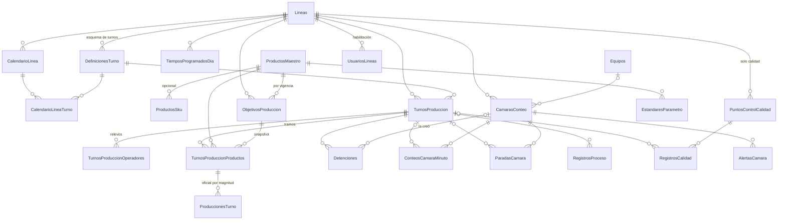

# T-798 · Rediseño del modelo de producción: el evento Turno

Este documento cubre la **Fase 1 (diagnóstico)** y la **Fase 2 (diseño)**. No se modificó código, scripts ni bases.
**Punto de control:** espera el OK de Emiliano antes de la Fase 3.

Base del análisis: `main` en `158d535`, más las ramas sin mergear T-783, T-784, T-785 y T-786.

---

## 0. Resumen

- Hoy el eje del sistema es la **detención**. El "turno" es solo una etiqueta (`TurnoId` + `Fecha`) que cada tabla calcula por su
  cuenta a partir de la hora. No existe **la instancia** "Tango 2, T2 del 12/11". Por eso nadie puede responder qué se
  produjo, con qué producto, quién operó y con qué eficiencia.
- Propuesta: un evento **`TurnosProduccion`** (línea + definición de turno + fecha de producción), con estas tablas hijas:
  - **operadores** (relevos; absorbe T-783);
  - **tramos de producto** (con snapshot del objetivo);
  - **producción declarada** (dato oficial, separado del conteo crudo);
  - las **detenciones**.
- El objetivo pasa al **producto maestro por línea**, con vigencia. Las cámaras salen de `PuntosControlCalidad` a una tabla
  propia, **`CamarasConteo`**, que es la única fuente de verdad de si la cámara está habilitada.
- Tres decisiones del cliente cambian los números:
  - objetivo de un turno que no dura 8 h;
  - relación entre manga y bolsón;
  - quién valida el conteo de la cámara.
  
  Van en la sección 2.9 con opciones.

### Correcciones al estado descrito en el pedido

| El pedido dice | En el código |
|---|---|
| "No hay tabla de productos" | **Sí existe `mnt.Productos`** (Código, Nombre, Descripción, Orden), con `mnt.LineasProductos`. La usan Control de Proceso (`EstandaresParametro`, `RegistrosProceso.ProductoId`) y Calidad (`RegistrosCalidad.ProductoId`). En producción el script 24 cargó **`HIGIENICO 30 MTS`** en Tango 2, con 54 estándares. Es una lista plana: no tiene maestro/SKU, ni objetivos, ni metros. |
| `mnt.Turnos` = T1/T2/T3 | Es **global, no por línea**. Cada línea solo elige, por día de la semana, cuáles corre (`CalendarioLinea` + `CalendarioLineaTurno`). La búsqueda del turno por hora toma el primer turno que contiene la hora. **No admite esquemas distintos por línea.** |
| T-783, T-784, T-785 y T-786 | Ninguna está en `main` ni en producción: son ramas. En DEV corren juntas, en la integración local. |

---

## 1. FASE 1 – Diagnóstico

### 1.1 Modelo actual (lo relevante para producción)

```mermaid
erDiagram
    Lineas ||--o{ Equipos : tiene
    Lineas ||--o{ CalendarioLinea : "plan por vigencia"
    CalendarioLinea ||--o{ CalendarioLineaTurno : "día de la semana → turno"
    Turnos ||--o{ CalendarioLineaTurno : ""
    Lineas ||--o{ TiemposProgramadosDia : "excepción de horas del día"
    Lineas ||--o{ UsuariosLineas : "usuario ↔ línea (+turno)"
    Turnos |o--o{ UsuariosLineas : "turno habitual"
    Lineas ||--o{ LineasProductos : ""
    Productos ||--o{ LineasProductos : ""
    Productos ||--o{ EstandaresParametro : "estándar por línea+producto"
    Lineas ||--o{ RegistrosProceso : ""
    Turnos ||--o{ RegistrosProceso : "TurnoId + Fecha"
    Productos |o--o{ RegistrosProceso : "opcional"
    Lineas ||--o{ PuntosControlCalidad : "cámaras + puntos de calidad"
    PuntosControlCalidad ||--o{ ConteosCamaraMinuto : ""
    PuntosControlCalidad ||--o{ ParadasCamara : ""
    PuntosControlCalidad ||--o{ AlertasCamara : ""
    PuntosControlCalidad ||--o{ RegistrosCalidad : "defectos T-611"
    Turnos |o--o{ ConteosCamaraMinuto : "TurnoId por hora"
    Turnos |o--o{ ParadasCamara : "TurnoId por hora"
    Lineas ||--o{ Detenciones : ""
    Turnos ||--o{ Detenciones : "FK_Detenciones_Turnos"
    UsuariosLineas |o--o{ Detenciones : "FK_Detenciones_UsuariosLineas (maquinista)"
    PuntosControlCalidad |o--o{ Detenciones : "cámara que la creó"
```



| Dato | Dónde | De dónde sale |
|---|---|---|
| Turno de una detención | `Detenciones.TurnoId` + `Fecha` | Manual: de la hora desde, del turno fijo del maquinista o de la hora actual (`DetencionCargaReglas.ElegirFuenteTurno`). Cámara: de la hora de parada. `Fecha`: manual = la tipeada; cámara = la fecha de la parada. |
| Maquinista de una detención | `Detenciones.UsuarioLineaId` → `UsuariosLineas` | Copia de la asignación (confirmada en T-783, o fija). |
| Producción | `ConteosCamaraMinuto.Rollos` (cámara 09 = rollos, cámara 10 = **mangas**) | Servicio de cámara, minuto a minuto. `TurnoId` calculado por hora. `LineaId` copiado del punto. |
| Objetivo | `PuntosControlCalidad.ObjetivoPorHora` × horas programadas del turno | Por cámara, fijo, sin producto. |
| Horas programadas | `CalendarioLinea` (+ `CalendarioLineaTurno`) + `TiemposProgramadosDia` | `TiempoProgramadoCalculador` (por día) y `EficienciaCamaraCalculador.MinutosProgramadosTurno` (por turno). |
| Indisponibilidad | Σ `Detenciones.MinutosEfectivos` del mes ÷ minutos programados del mes | `DashboardService.ObtenerIndisponibilidadAsync`. |
| Acumulado del turno | Detenciones con `TurnoId` = turno actual **y `Fecha` = hoy** | `DetencionesController.GetResumenTurno`. |
| Producto del turno | — | **No existe.** `RegistrosProceso.ProductoId` es opcional y es de otra cosa (control de proceso). |
| Estado de una cámara | `PuntosControlCalidad.Activo` **y** `appsettings(.local).json` → `Camaras[i].Activa` | Dos fuentes, unidas por `Codigo`. |

### 1.2 Problemas concretos

**El turno no existe como hecho**

1. **No hay instancia de turno.** Cada tabla "re-deriva" el turno con su propia regla: detenciones, conteos, paradas, registros de proceso y calidad. No se puede saber si un turno se trabajó, quién lo abrió ni cuándo empezó y terminó de verdad.
2. **"Fecha" significa cosas distintas.**
   - La eficiencia asigna el turno noche al día en que empieza.
   - `Detenciones.Fecha` guarda la fecha de la parada (después de medianoche, el día siguiente).
   - En las manuales, la fecha es la que se tipea.
   
   El mismo turno T3 queda partido en dos días según el reporte.
3. **El acumulado del turno pierde el T3**: filtra `Fecha = hoy`, así que después de medianoche no ve lo que pasó antes.
4. **Los turnos son globales.** No hay esquema por línea: un T3 de 9 h en una línea y de 8 h en otra es imposible. Si se cargan turnos que se superponen, `GetTurnoPorHoraAsync` toma el primero.

**Maquinista y usuarios**

5. **`UsuariosLineas` mezcla dos conceptos**: el permiso para operar en una línea (restricción del operario, validada en backend) y el maquinista habitual de un turno. El índice único usuario+línea impide dar dos turnos habituales.
6. **`Detenciones.UsuarioLineaId` apunta a una asignación editable.**
   - Si el admin cambia la línea o el turno de esa asignación (`PUT catalogos/maquinistas`), las detenciones históricas "cambian" de maquinista.
   - Por esa FK, una asignación usada no se puede borrar y se desactiva.
   - El maquinista es una persona en un momento: debería guardarse el usuario (snapshot), no la asignación.
7. **T-783 (rama)** agregó `MaquinistasTurno` (línea + turno + día) sin FK desde `Detenciones`, y copia el `UsuarioLineaId`. Es un evento turno a medias.

**Producto y objetivo**

8. **El objetivo está en la cámara** (`ObjetivoPorHora`), no en el producto. No puede variar entre SH 30 y SH 50.
9. **`Productos` es plano**: no distingue producto maestro de SKU, ni tiene metros por manga ni unidades por pack.
   - No se sabe si `HIGIENICO 30 MTS` (producción) es el mismo maestro que "HIGIÉNICO SH 30 mts x 4 – PH1 20".
10. **No hay producto por turno ni por tramo horario.** Velocidad (m/min) y eficiencia por producto no se pueden calcular.

**Cámaras y conteos**

11. **Nombres que engañan.**
    - `ConteosCamaraMinuto.Rollos` guarda mangas en la cámara 10.
    - `PuntosControlCalidad` guarda cámaras de producción.
    - "Puntos de control de proceso" en Maestros son `GruposParametro`.
    - `Detenciones.PuntoControlCalidadId` es en realidad "la cámara que la creó".
12. **`PuntosControlCalidad` mezcla dos cosas**: cámaras de conteo (método, umbrales, objetivo) y puntos de inspección de defectos (T-611). Cada uno usa la mitad de las columnas.
13. **Dos fuentes de verdad del estado de la cámara** (`Activo` en la tabla, `Activa` en appsettings). Ya se contradijeron con la cámara 10.
14. **El tipo de cámara se deduce.**
    - La línea de la cámara está por FK, pero el código lleva el prefijo `T2-` y se usa como convención.
    - La cantidad de carriles no está en ningún lado: se deduce de los datos (`Unidad` "1 carril = mangas").
15. **No se distingue "sin datos" de "producción cero"** en los reportes.
    - El minuto trae `SegundosSinSenal`, pero si no llega ningún minuto, el turno muestra 0.
    - No se ve cuándo fue el último dato de cada cámara (solo hay alertas de video congelado o sin video).
16. **El conteo crudo es el dato oficial.** No hay confirmación, corrección ni origen.

**Datos copiados**

17. `LineaId` está copiado en `ConteosCamaraMinuto`, `ParadasCamara`, `AlertasCamara` y `RegistrosCalidad`, cuando se deriva del punto. `TurnoId` se recalcula por fila.

**No escala a 5 líneas**

18. Además de 4, 8 y 13:
    - `ObjetivoPorHora` es uno solo por cámara;
    - la eficiencia toma una cámara como "la" producción de la línea;
    - las convenciones de código (`T2-CAM09`) son el único vínculo entre cámara y appsettings.

### 1.3 Preguntas que hoy el sistema no puede responder

1. ¿Qué produjo Tango 2 en el T2 del 12/11, **con qué producto** y con qué eficiencia?
2. ¿Quién operó Tango 2 el T3 del 19/11, hubo relevo, y a qué hora?
3. ¿Ese turno se trabajó? (¿o no hay datos porque la cámara estaba apagada?)
4. ¿Cuántas mangas por minuto, o qué velocidad en m/min, tuvo SH 50 la semana pasada?
5. ¿Cuánto tiempo de cambio de producto hubo en noviembre?
6. ¿El 0 de producción de un turno es cero real o falta de datos?
7. ¿Qué detenciones pasaron en el T3 del 19/11 completo (antes y después de medianoche) y cuánto suman?
8. ¿Qué cámaras están mandando datos ahora y cuál fue su último minuto?

---

## 2. FASE 2 – Diseño

### 2.1 Principios

- El eje es **`TurnosProduccion`**. Todo hecho operativo (conteo, parada, detención, producción declarada, registro de proceso, defecto de calidad) cuelga de un turno de producción o puede asociarse a uno.
- **Snapshot** de lo que puede cambiar: objetivo, metros por manga, horario programado, operador. Es la misma regla que `ValorEstandarSnapshot` (trampa 3) y el turno materializado (trampa 4).
- **Insert-only** donde ya rige: detenciones, historial, producción declarada, operadores. Las correcciones son registros nuevos.
- **Nombres que dicen lo que guardan.** Sin prefijos de línea en los códigos como convención.
- Todo por **línea**: turnos, objetivos, cámaras.

### 2.2 Modelo de datos propuesto

Tipos SQL Server (en SQLite de DEV se mapean igual). Todas las tablas de catálogo heredan la auditoría de siempre:
`FechaHoraCreacion`, `FechaHoraModificacion`, `CreadoPorUsuarioId` y `ModificadoPorUsuarioId`, más `Activo` en los catálogos.

#### Catálogos

**`mnt.DefinicionesTurno`** (transforma `mnt.Turnos`). Por qué: los turnos pasan a ser por línea, y el nombre distingue la *definición* del *evento*.

| Columna | Tipo | Notas |
|---|---|---|
| `DefinicionTurnoId` | INT IDENTITY PK | Conserva los ids de `Turnos` en la migración. |
| `LineaId` | INT NOT NULL FK `Lineas` | **Nuevo.** Cada línea con su esquema. |
| `Codigo` | NVARCHAR(10) | T1, T2, T3. Único por línea (`UX_DefinicionesTurno_Linea_Codigo`). |
| `Nombre` | NVARCHAR(50) | |
| `HoraInicio`, `HoraFin` | TIME | Si fin ≤ inicio, cruza medianoche. La duración sale de acá (T3 de 9 h = 21:00–06:00). |
| `Orden` | INT | |
| `Activo` | BIT | |

- Regla: dentro de una línea, las definiciones activas **no se superponen** (se valida en backend; no hay CHECK entre filas).
- `CalendarioLineaTurno.TurnoId` → `DefinicionTurnoId`, con la validación de que la definición sea de la misma línea.
- `TiemposProgramadosDia` sigue igual.

**`mnt.ProductosMaestro`** (transforma `mnt.Productos`: se renombra y se agregan columnas; **se conservan los ids**, así no se rompen `EstandaresParametro`, `RegistrosProceso` ni `RegistrosCalidad`).

| Columna | Tipo | Notas |
|---|---|---|
| `ProductoMaestroId` | INT PK | Ex `ProductoId`. |
| `Codigo` | NVARCHAR(50) UNIQUE | Ej.: `SH30X4-PH1-20`. |
| `Nombre` | NVARCHAR(100) | "HIGIÉNICO SH 30 mts x 4 – PH1 20". |
| `TipoProducto` | NVARCHAR(30) | HIGIENICO, ROLLO_COCINA… Catálogo chico; ver pregunta abierta. |
| `MetrosPorRollo` | DECIMAL(9,2) NOT NULL | 30 / 50. Lo que el cliente llama "metros por manga": ver nota abajo. |
| `RollosPorManga` | INT NULL | El "x 4" del nombre. Confirmar. |
| `MangasPorBolson` | DECIMAL(9,2) NULL | **No se supone** (pregunta abierta). |
| `Descripcion`, `Orden`, `Activo` | | Como hoy. |

> **Metros por manga.** El pedido dice "metros/manga = 30", pero si la manga es un pack de 4 rollos de 30 m, la manga tiene
> 120 m. Para la velocidad en m lineales/min importa cuál es. Queda como pregunta abierta: guardo `MetrosPorRollo` y
> `RollosPorManga`, y la velocidad se define con la respuesta.

**`mnt.ProductosSku`** (nueva, opcional). Por qué: el objetivo es del maestro; el SKU solo identifica la presentación comercial (ERP, calidad). Puede quedar vacía.

| Columna | Tipo | Notas |
|---|---|---|
| `ProductoSkuId` | INT PK | |
| `CodigoSku` | NVARCHAR(50) UNIQUE | |
| `Descripcion` | NVARCHAR(200) | |
| `ProductoMaestroId` | INT FK | Varios SKU → un maestro. |

**`mnt.ObjetivosProduccion`** (nueva). Por qué: **el objetivo es por producto + línea** (el mismo producto puede correr a distinta velocidad en otra línea), con vigencia para no reescribir el histórico. Reemplaza `PuntosControlCalidad.ObjetivoPorHora`.

| Columna | Tipo | Notas |
|---|---|---|
| `ObjetivoProduccionId` | INT PK | |
| `LineaId` | INT FK | |
| `ProductoMaestroId` | INT FK | |
| `VigenteDesde` | DATE | Único (Línea, Producto, VigenteDesde). |
| `MangasObjetivoTurno` | INT NOT NULL | 11.200 / 6.720. |
| `BolsonesObjetivoTurno` | INT NULL | 6.500 / 4.700. Null = no se mide. |
| `MinutosTurnoReferencia` | INT NOT NULL DEFAULT 480 | Duración a la que corresponde el objetivo (pregunta abierta para T3 de 9 h). |

`LineasProductos` queda como "producto habilitado en la línea" (lo usa Control de Proceso), con el FK renombrado a `ProductoMaestroId`.

#### Evento turno

**`mnt.TurnosProduccion`** (nueva, eje del modelo)

| Columna | Tipo | Notas |
|---|---|---|
| `TurnoProduccionId` | BIGINT PK | |
| `LineaId` | INT FK | |
| `DefinicionTurnoId` | INT FK | De la misma línea. |
| `FechaProduccion` | DATE | **Día en que empieza el turno** (regla única para todo el sistema). |
| `InicioProgramado`, `FinProgramado` | DATETIMEOFFSET | Snapshot de la definición al crear el turno. |
| `MinutosProgramados` | INT | Snapshot: calendario más excepción del día (0 = no programado). |
| `InicioReal` | DATETIMEOFFSET NULL | Apertura. |
| `FinReal` | DATETIMEOFFSET NULL | Cierre. |
| `Estado` | NVARCHAR(20) | `ABIERTO`, `CERRADO`, `CERRADO_AUTOMATICO`, `SIN_APERTURA` (CHECK). |
| `OrigenApertura` | NVARCHAR(20) | `LOGIN`, `SUPERVISOR`, `SISTEMA` (lo abrió una detección o un conteo). |
| `AbiertoPorUsuarioId`, `CerradoPorUsuarioId` | NVARCHAR(450) NULL | |
| `ObservacionCierre` | NVARCHAR(500) NULL | |
| `RowVersion` | ROWVERSION | |

- Único (`LineaId`, `DefinicionTurnoId`, `FechaProduccion`).
- **Un solo turno abierto por línea**: índice único filtrado `UX_TurnosProduccion_LineaAbierto ON (LineaId) WHERE Estado = 'ABIERTO'`.
- Índice (`LineaId`, `FechaProduccion`).

**`mnt.TurnosProduccionOperadores`** (nueva; **reemplaza `MaquinistasTurno` de T-783**). Por qué: los relevos son tramos dentro del turno, y una tabla hija del evento los representa sin otra clave paralela (línea + turno + día).

| Columna | Tipo | Notas |
|---|---|---|
| `TurnoProduccionOperadorId` | BIGINT PK | |
| `TurnoProduccionId` | BIGINT FK | |
| `OperadorUsuarioId` | NVARCHAR(450) | **El usuario**, no la asignación. |
| `Desde` | DATETIMEOFFSET | |
| `Hasta` | DATETIMEOFFSET NULL | Null = sigue. |
| `Origen` | NVARCHAR(20) | `LOGIN`, `SUPERVISOR`. |
| `RegistradoPorUsuarioId` | NVARCHAR(450) | |
| `Motivo` | NVARCHAR(500) NULL | Obligatorio si es `SUPERVISOR`. |
| `AnuladoPorId` | BIGINT NULL FK self | Corrección insert-only: el registro nuevo anula al anterior. |

Regla: sin superposición entre los tramos no anulados de un turno.

**`mnt.TurnosProduccionProductos`** (nueva): tramos de producto con snapshot del objetivo.

| Columna | Tipo | Notas |
|---|---|---|
| `TurnoProduccionProductoId` | BIGINT PK | |
| `TurnoProduccionId` | BIGINT FK | |
| `ProductoMaestroId` | INT FK | |
| `Desde` | DATETIMEOFFSET | |
| `Hasta` | DATETIMEOFFSET NULL | |
| `ObjetivoProduccionId` | INT FK | Qué versión de objetivo se usó. |
| `MangasObjetivoTurnoSnapshot` | INT | |
| `BolsonesObjetivoTurnoSnapshot` | INT NULL | |
| `MinutosTurnoReferenciaSnapshot` | INT | |
| `MetrosPorRolloSnapshot`, `RollosPorMangaSnapshot` | DECIMAL / INT | Para la velocidad. |
| `DeclaradoPorUsuarioId` | NVARCHAR(450) | |
| `Origen` | NVARCHAR(20) | `LOGIN`, `CAMBIO`, `SUPERVISOR`. |
| `AnuladoPorId` | BIGINT NULL FK self | |

Regla: los tramos no anulados cubren sin superponerse; un cambio de producto cierra el tramo anterior.

**`mnt.ProduccionesTurno`** (nueva): dato **oficial** de producción, por tramo de producto y magnitud.

| Columna | Tipo | Notas |
|---|---|---|
| `ProduccionTurnoId` | BIGINT PK | |
| `TurnoProduccionProductoId` | BIGINT FK | |
| `Magnitud` | NVARCHAR(10) | `MANGAS`, `BOLSONES`, `ROLLOS` (CHECK). |
| `CantidadCamara` | DECIMAL(12,1) NULL | Calculada del conteo crudo al cerrar el tramo. Null = sin cámara. |
| `MinutosConDatos` | INT NULL | Cobertura del conteo. |
| `CantidadOficial` | DECIMAL(12,1) NULL | Lo que cuenta para los indicadores. |
| `Origen` | NVARCHAR(20) | `CAMARA`, `CAMARA_CORREGIDA`, `MANUAL`. |
| `EstadoValidacion` | NVARCHAR(20) | `PENDIENTE`, `VALIDADA`, `SIN_DATOS`. |
| `ValidadoPorUsuarioId`, `FechaHoraValidacion` | | |
| `AnuladoPorId` | BIGINT NULL FK self | Insert-only. |

Así quedan separados el conteo crudo (`ConteosCamaraMinuto`) y el dato oficial, que tiene origen y estado de validación. "Sin datos" (`SIN_DATOS`, cantidad null) queda distinto de "cero" (0, `VALIDADA`). Mientras no haya cámara de bolsones, se cargan a mano (`MANUAL`) o la fila no se crea y el indicador se omite.

#### Cámaras

**`mnt.CamarasConteo`** (nueva; sale de `PuntosControlCalidad`)

| Columna | Tipo | Notas |
|---|---|---|
| `CamaraConteoId` | INT PK | |
| `Codigo` | NVARCHAR(30) UNIQUE | Clave con el servicio, **sin significado**: la línea va por FK. |
| `Nombre` | NVARCHAR(100) | |
| `LineaId` | INT FK | |
| `EquipoId` | INT NULL FK | Equipo que ve. Se propone en la detención. |
| `NumeroCanalGrabador` | INT | 8, 9, 10. El servicio arma la ruta RTSP con esto. |
| `Magnitud` | NVARCHAR(10) | `ROLLOS`, `MANGAS`, `BOLSONES` (CHECK). |
| `MetodoDeteccion` | NVARCHAR(20) | `CARRILES`, `PASOS` (técnica). |
| `CantidadCarriles` | TINYINT | 4 en la 09, 1 en la 10 y la 8. |
| `CuentaProduccionOficial` | BIT | Qué cámara alimenta `ProduccionesTurno` para su magnitud. Una por línea y magnitud: índice único filtrado. Reemplaza `IncluirEnEficiencia` (T-785). |
| `DetectaParadas`, `CreaDetenciones` | BIT | |
| `UmbralDetencionSegundos` | INT | **Un solo campo**: reemplaza minutos y segundos (30 a 14400). |
| `Habilitada` | BIT | **Única fuente de verdad**: el servicio lee la lista de la API. |
| `UltimoMinutoRecibido` | DATETIMEOFFSET NULL | Se actualiza en cada lote. |
| `Activo` | BIT | Catálogo. |

- La parte técnica (zona de imagen, umbrales de píxeles, fps) sigue en el appsettings del servicio, porque es calibración. Pero **qué cámaras corren lo decide la tabla**.
- Si una cámara está habilitada y el server no tiene su calibración, se abre una alerta `SIN_CONFIGURACION`.

**`mnt.ConteosCamaraMinuto`** (se transforma)

| Columna | Cambio |
|---|---|
| `Rollos` | → **`Cantidad`** (la magnitud la da la cámara). |
| `PuntoControlCalidadId` | → `CamaraConteoId`. |
| `TurnoId` | → **`TurnoProduccionId`** NULL (null = no había turno: ver reglas). |
| `LineaId` | **Se elimina** (se deriva de la cámara). |
| El resto | Igual: segundos de marcha, parada, acumulación y sin señal, y estado. |

**`mnt.ParadasCamara`** y **`mnt.AlertasCamara`**:
- `PuntoControlCalidadId` → `CamaraConteoId`; `TurnoId` → `TurnoProduccionId`;
- se elimina `LineaId`;
- `ParadasCamara` conserva `UmbralSegundos` y `SuperaUmbral` (T-784).

**`mnt.PuntosControlCalidad`** queda **solo para calidad** (T-611). Se le quitan `NumeroCamara`, `CreaDetenciones`, los umbrales, `ObjetivoPorHora`, `MetodoConteo` y `IncluirEnEficiencia`. El nombre ya es correcto para lo que queda.

En Maestros, "Puntos de control de proceso" (`GruposParametro`) pasa a llamarse **"Grupos de variables de proceso"** (solo la pantalla), para no chocar con calidad.

#### Detenciones

`mnt.Detenciones` (se transforma):

| Columna | Cambio |
|---|---|
| `TurnoProduccionId` | **Nueva**, BIGINT NOT NULL FK. Toda detención cuelga de un turno. |
| `TurnoId` y `Fecha` | **Se eliminan** (salen del turno: `DefinicionTurnoId`, `FechaProduccion`). |
| `UsuarioLineaId` | → **`OperadorUsuarioId`** NVARCHAR(450) NULL. Snapshot del operador vigente a la hora de la parada. |
| `PuntoControlCalidadId` | → `CamaraConteoId`. |
| `IdentificadorParadaCamara` | Se mantiene. Opcional: FK a `ParadasCamara.ParadaCamaraId` en lugar del texto. |

`RegistrosProceso` y `RegistrosCalidad` (`TurnoId` + `Fecha`): reciben `TurnoProduccionId` y dejan de recalcular el turno. Es la misma regla.

`UsuariosLineas` queda como **habilitación del usuario en la línea** (permiso). `TurnoId` pasa a `DefinicionTurnoHabitualId` NULL: solo sirve para proponer el operador y para avisar si alguien de otro turno se confirma. Al no tener FKs desde `Detenciones`, se puede editar libremente.

### 2.3 Diagrama del modelo propuesto



### 2.4 Qué pasa con cada tabla actual

| Tabla actual | Destino |
|---|---|
| `Turnos` | **Renombrar** a `DefinicionesTurno` y agregar `LineaId`. Las 3 globales se copian a cada línea (ids nuevos por línea; Tango 2 conserva los actuales). |
| `Productos` | **Renombrar** a `ProductosMaestro` y agregar columnas. |
| `LineasProductos` | Se queda (FK renombrado). |
| `PuntosControlCalidad` | **Transformar**: las filas de cámaras (con `NumeroCamara` o `MetodoConteo`) **se mueven** a `CamarasConteo` y sus columnas de cámara se eliminan. |
| `ConteosCamaraMinuto`, `ParadasCamara`, `AlertasCamara` | **Transformar** (columnas renombradas y FKs nuevas; sin `LineaId`). |
| `Detenciones` | **Transformar** (`TurnoProduccionId`, `OperadorUsuarioId`, `CamaraConteoId`; sin `TurnoId`, `Fecha` ni `UsuarioLineaId`). |
| `RegistrosProceso`, `RegistrosCalidad` | Agregar `TurnoProduccionId`. |
| `UsuariosLineas` | Se queda como habilitación (`TurnoId` → `DefinicionTurnoHabitualId`). |
| `MaquinistasTurno` (T-783, script 31) | **No se despliega.** Se reemplaza por `TurnosProduccionOperadores`. |
| Script 33 (T-785: `IncluirEnEficiencia`, BOLSONES en el CHECK) | **No se despliega.** Lo reemplazan `CamarasConteo.CuentaProduccionOficial` y `Magnitud`. |
| Script 32 (T-784: marca de umbral) | Se mantiene sobre `ParadasCamara` renombrada. |

### 2.5 Ciclo de vida del turno y reglas

```
          (nadie lo abrió y pasó InicioProgramado + tolerancia)
 [no existe] ───────────────────────────────────────────────► SIN_APERTURA ──(alguien entra)──► ABIERTO
     │ login del operador / supervisor / detección de la cámara                              │
     └──────────────────────────────────────────────────────────────────────► ABIERTO ──────┤
                                                                                           │ cierre manual (operador o supervisor)
                                                                                           │ o automático: FinProgramado + tolerancia,
                                                                                           │ o al abrir el turno siguiente de la línea
                                                                                           ▼
                                                                          CERRADO / CERRADO_AUTOMATICO
```

1. **Apertura en el login (T-783).** El operador habilitado en la línea entra.
   - Si no hay turno abierto de esa línea para la definición en curso, se crea y queda `ABIERTO`, con él como primer operador.
   - Se le pide el **producto con el que arranca**, o se le propone el del turno anterior.
   - Si el turno ya está abierto con otro operador, se le pregunta si lo releva. Si dice que sí, se cierra el tramo anterior y empieza el suyo (`TurnosProduccionOperadores`).
2. **Un solo turno abierto por línea** (índice filtrado). Abrir el turno siguiente cierra el anterior como `CERRADO_AUTOMATICO`. Esto resuelve el cambio de turno sin depender de que alguien cierre.
3. **Cierre automático**: un job cada minuto cierra los turnos con `FinProgramado + 30 min` (tolerancia configurable) vencido.
4. **Turno que nadie abrió.**
   - Si llega un conteo, una parada de cámara o una detención manual para una línea y hora sin turno abierto, se **abre solo** (`OrigenApertura = SISTEMA`), sin operador ni producto. Queda marcado "a completar".
   - Si la hora cae en una definición **no programada** ese día, se abre igual, con `MinutosProgramados = 0` (horario extra). Ver pregunta abierta.
   - Nunca se pierde un dato por falta de turno.
5. **Turno que cruza medianoche**: `FechaProduccion` es el día de inicio, siempre. Los conteos, paradas y detenciones después de las 00:00 cuelgan del mismo turno. Esto arregla los problemas 2 y 3.
6. **Cambio de producto**: el operador declara "cambio a X a las HH:mm". Se cierra el tramo vigente y se abre uno nuevo, con **snapshot del objetivo vigente**. El tiempo de cambio cuenta para el tramo nuevo, salvo que el cliente decida otra cosa (pregunta abierta).
7. **Detenciones**:
   - la manual toma el turno abierto de la línea, o el que corresponda a la hora desde (lo abre si hace falta);
   - la de cámara toma el turno de su hora de parada;
   - `OperadorUsuarioId` es el operador vigente a esa hora.
8. **Correcciones de un turno cerrado** (operador, producto o producción): solo supervisor o admin, con motivo, como registro nuevo que anula al anterior. Qué roles pueden hacerlo es pregunta abierta.
9. **Producción oficial al cerrar el turno**:
   - por cada tramo y magnitud, se calcula `CantidadCamara` sumando los minutos de la cámara `CuentaProduccionOficial` dentro del tramo;
   - si la cobertura es menor al 90 % (parámetro) de los minutos con turno abierto, el estado es `SIN_DATOS` y se pide carga manual;
   - si no, queda `PENDIENTE` de validación (o se valida sola, según la respuesta del cliente).

### 2.6 Indicadores, con ejemplos numéricos

Productos: **A** = SH 30 (11.200 mangas y 6.500 bolsones por turno; 30 m) y **B** = SH 50 (6.720 mangas y 4.700 bolsones por turno; 50 m). Supuesto marcado: `MinutosTurnoReferencia = 480`.

**Objetivo de un tramo** = `ObjetivoTurno × minutos del tramo ÷ MinutosTurnoReferencia`.
**Objetivo del turno** = Σ de los tramos. **Eficiencia** = Σ producción oficial ÷ Σ objetivo (de la línea, el turno o el período, sumando numerador y denominador, nunca promediando porcentajes).

| Caso | Tramos | Objetivo mangas | Producido | Eficiencia |
|---|---|---|---|---|
| 1. T1 de 8 h, solo A | A 06:00–14:00 (480 min) | 11.200 | 10.080 | **90,0 %** |
| 2. T2 con cambio de producto | A 14:00–17:00 (180) + B 17:00–22:00 (300) | 11.200×180/480 + 6.720×300/480 = 4.200 + 4.200 = **8.400** | 3.900 + 3.850 = 7.750 | **92,3 %** (A 92,9 %; B 91,7 %) |
| 3a. T3 de 9 h con B, prorrateado | B 21:00–06:00 (540) | 6.720×540/480 = **7.560** | 6.900 | **91,3 %** |
| 3b. T3 de 9 h con B, objetivo fijo por turno | igual | **6.720** | 6.900 | **102,7 %** |

Los casos 3a y 3b muestran por qué la pregunta abierta 2 cambia el número.

**Producción de bolsones** (mismo prorrateo):
- caso 2: 6.500×180/480 + 4.700×300/480 = 2.437,5 + 2.937,5 = **5.375** de objetivo;
- con 5.000 contados, 93,0 %.

Mientras no haya cámara de bolsones: si no hay `ProduccionesTurno` de BOLSONES, el indicador se muestra como **"sin datos"** (nunca 0 %).

**Velocidad** (m lineales/min) = mangas en el minuto × metros de la manga del producto **vigente en ese minuto** (el tramo da el producto).
- Promedio de un tramo = Σ mangas ÷ minutos en marcha (`SegundosMarcha`) × metros por manga.
- Ejemplo A: 23,3 mangas/min × 30 m = **700 m/min**. Ejemplo B: 14 mangas/min × 50 m = **700 m/min**.
- Dato útil: los dos objetivos equivalen a **700 m/min** en 8 h (11.200 ÷ 480 × 30 = 6.720 ÷ 480 × 50 = 700). Parece que el objetivo sale de una velocidad de línea de 700 m/min. Si se confirma, el objetivo podría derivarse de la velocidad. Además, sugiere que "metros por manga" = metros de la manga tal como se cuenta, y no por rollo (confirmar).

**Indisponibilidad** = Σ minutos de detención de los turnos ÷ Σ `MinutosProgramados` de esos turnos.
- Sigue funcionando: los minutos programados ahora salen del snapshot del turno (que se arma con el mismo calendario y las mismas excepciones).
- Si en un día no hay turnos, se usa el calendario, como hoy (así los meses sin uso dan igual).

**Horas programadas**: `TiempoProgramadoCalculador` no cambia; pasa a usar `DefinicionesTurno` de la línea.

**Relación manga/bolsón** (no se supone): con los objetivos, A tiene 0,58 bolsones por manga y B 0,70. **No es constante**, así que el conteo de una cámara no sirve para validar el de otra hasta que el cliente defina la relación.

### 2.7 Impacto

| Área | Cambio |
|---|---|
| **Login** | Pantalla de T-783 ampliada: confirmar línea y turno, elegir el producto con el que arranca y aceptar el relevo si hay otro operador. |
| **Barra de turno (nueva)**, en todas las pantallas del operador | "Tango 2 · T2 · SH 30 desde 14:00 · Op. Juan". Botones: *Cambiar producto*, *Cerrar turno*. |
| **Nueva detención / declarar** | Ya no se elige fecha ni turno: se toma el turno abierto, o el de la hora desde para cargar algo pasado (supervisor). Se muestra el operador del turno. |
| **Acumulado del turno** | Por `TurnoProduccionId`: arregla el T3. Suma producción, objetivo a la hora y eficiencia parcial. |
| **Maestros** | Productos maestro (con objetivos por línea y vigencia, y SKU opcional); Turnos por línea; **Cámaras de conteo** (pantalla propia, con estado "último minuto recibido"); Calidad sin campos de cámara. |
| **Dashboards** | Eficiencia por línea y turno desde `ProduccionesTurno` + tramos (un solo cálculo; se elimina el de cámara con `ObjetivoPorHora`). Velocidad por producto. Indisponibilidad sobre turnos. |
| **Supervisor** | Pantalla *Turnos de producción*: listado por día y línea; completar los abiertos por el sistema; validar la producción; corregir operador o producto con motivo. Absorbe *Maquinistas del turno* de T-783. |
| **API** | `api/turnos-produccion` (abrir, relevar, cambiar producto, cerrar, corregir, validar producción), `api/productos-maestro`, `api/camaras-conteo`, `api/camaras-conteo/configuracion` (para el servicio, con la clave de ingesta). |
| **Ingesta** | El campo `puntoControl` del lote pasa a `camara` (código de `CamarasConteo`); el contenido del minuto `rollos` pasa a `cantidad`. Durante la transición, la API acepta los dos nombres. La API asigna `TurnoProduccionId` (y abre el turno si falta). Actualiza `UltimoMinutoRecibido`. |
| **Servicio de cámaras** | Al arrancar, y cada 5 min, pide `configuracion`: qué cámaras están habilitadas, su canal y su magnitud. Corre las que tienen calibración local. En el appsettings: se quita `Activa` y `PuntoControl` pasa a `Camara`; las zonas y los umbrales de imagen se quedan. |
| **Alertas** | Nueva `SIN_DATOS`: turno abierto y la cámara oficial sin minutos hace más de 5 min. Se ve en el Dashboard y en Mis pendientes. |
| **Roles** | Operario: abrir, relevarse, cambiar producto y cerrar **su** turno. Supervisor y mantenimiento: corregir, validar y completar. Admin: maestros. Gerencia: lectura. |

### 2.8 Datos de prueba actuales

| Opción | Cómo | Pros | Contras / qué se pierde |
|---|---|---|---|
| **A. Reiniciar** | Se vacían las tablas transaccionales (detenciones, conteos, paradas, alertas, registros de proceso y calidad). Se conservan los catálogos, los estándares y los usuarios. | Simple, sin datos raros; el modelo arranca limpio. | Se pierde la historia de prueba de Tango 2: la comparación de cámara y detenciones del 13/11 y los registros de proceso. |
| **B. Convertir con turnos inferidos** *(recomendada)* | Un script crea un `TurnoProduccion` por cada (línea, turno, fecha de producción) con datos, con estado `CERRADO`, origen `SISTEMA` y sin producto. Cuelga ahí detenciones, conteos y registros. Operador = el del `UsuarioLineaId` de la detención, si hay. | Conserva todo para comparar y probar reportes. Valida el script de migración que habría que usar igual en las otras líneas. | Turnos sin producto: la eficiencia histórica queda "sin objetivo" salvo que se cargue el producto a mano. Hay que decidir qué hacer con las detenciones de cámara pendientes. |
| C. Migrar 1:1 con producto | Como B, más asignar `HIGIENICO 30 MTS` a todos los tramos. | Eficiencia histórica calculable. | **Inventa un dato**: no sabemos qué producto corrió. No recomendado sin confirmación. |

Recomiendo **B** y, si molesta, se borra después (son datos de prueba). Antes de cualquier opción: backup de la base y de `C:\PSAG_Mantenimiento\Adjuntos`.

### 2.9 Preguntas abiertas para el cliente

1. **Validación del conteo de cámara contra el contador de la máquina.**
   - Opciones: (a) el supervisor valida cada turno; (b) se valida sola si la cobertura es ≥ 90 % y el supervisor solo corrige; (c) se carga el contador de la máquina a mano y la cámara queda como referencia.
   - ¿Quién valida? ¿Hay contador en la máquina?
2. **Objetivo de un turno que no dura 8 h** (T3 de 9 h, turnos cortos, cambio de producto).
   - Opciones: (a) prorrateo por minuto (caso 3a); (b) objetivo fijo por turno, con prorrateo solo en cambios de producto (3b); (c) objetivo por hora de la línea (deriva de los 700 m/min).
3. **SKU vs. producto maestro.**
   - ¿`HIGIENICO 30 MTS` (producción, con 54 estándares de proceso) es el mismo maestro que "SH 30 mts x 4 – PH1 20"?
   - ¿Hace falta registrar el SKU, y de dónde sale (ERP)?
4. **Metros por manga.** ¿30 es por rollo o por manga? ¿Una manga = 4 rollos?
5. **Relación rollo / manga / bolsón.** ¿Cuántos rollos por manga y cuántas mangas por bolsón, por producto? (Los objetivos dan 0,58 y 0,70 bolsones por manga, que no es constante.)
6. **Quién corrige un turno cerrado** (operador, producto, producción).
   - Opciones: (a) solo supervisor de la línea; (b) supervisor y mantenimiento; (c) además, un plazo (por ejemplo 48 h) después del cual solo admin.
7. **Otras 4 líneas.** ¿Mismo esquema de turnos (¿T3 de 9 h en todas?), mismas magnitudes (¿mangas y bolsones o rollos?) e indicadores?
8. **Horas reales de cada turno en Tango 2** (si el T3 es de 9 h, ¿el T2 es de 7 h?).
9. **Tiempo de cambio de producto**: ¿cuenta contra el objetivo del producto nuevo, del anterior, o se descuenta como parada programada?
10. **Producción fuera de horario programado** (turno no programado que igual se trabaja): ¿cuenta para la eficiencia con objetivo completo, o solo se informa?
11. **Paradas programadas** (preventivo, limpieza, falta de programa): ¿restan de los minutos programados, o cuentan como indisponibilidad?
12. **Tolerancias**: el cierre automático (propuesta: 30 min después del fin) y la cobertura mínima de datos (propuesta: 90 %).

### 2.10 Plan de la Fase 3 (para el OK)

Cada etapa compila, tiene tests y se verifica en DEV. Cada una lleva su script numerado desde el **34**, idempotente, con rollback.

1. **Productos maestro**: renombrar `Productos`, agregar columnas, `ObjetivosProduccion` y `ProductosSku`. Maestros con los dos productos de Tango 2. *Tests*: vigencia del objetivo y unicidad.
2. **Turnos por línea y evento turno**: `DefinicionesTurno` (+ `LineaId`), `TurnosProduccion`, `TurnosProduccionOperadores` y `TurnosProduccionProductos`. Login de T-783 rehecho sobre el evento. Cierre automático. *Tests*: un abierto por línea, T3 que cruza medianoche, relevo, cambio de producto, turno sin apertura.
3. **Detenciones colgadas del turno**: `TurnoProduccionId` y `OperadorUsuarioId`; acumulado del turno. *Tests*: detención sin turno abierto (lo abre), detención después de medianoche.
4. **Cámaras**: `CamarasConteo`, renombres en los conteos, configuración desde la API, `UltimoMinutoRecibido`, alerta `SIN_DATOS`. T-785 alineada (bolsones = magnitud). *Tests*: cámara sin datos, ingesta con los dos formatos.
5. **Indicadores**: `ProduccionesTurno`, eficiencia, producción, velocidad e indisponibilidad sobre turnos. *Tests*: prorrateo, cambio de producto, T3 de 9 h (las dos variantes), sin datos ≠ cero.
6. **Pantallas**: barra de turno, *Turnos de producción* (supervisor), Maestros y Dashboard.
7. **Migración de los datos de prueba** (opción elegida) y paquete para producción: scripts en orden, backup, cambios de appsettings y consultas de verificación.

Las ramas T-783, T-784, T-785 y T-786 se rebasan sobre este modelo:

- **T-784 y T-786** entran casi como están: el detector de la cámara y la marca de umbral; la declaración manual sobre el turno.
- **T-783 y T-785** se reescriben dentro de las etapas 2 y 4. Sus scripts 31 y 33 no se despliegan.
