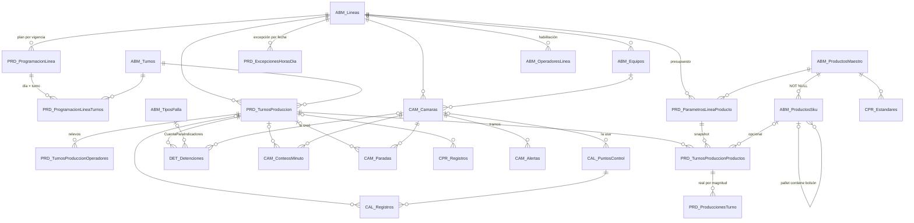

# T-798 · Rediseño del modelo de producción: el evento Turno

Este documento cubre la **Fase 1 (diagnóstico)** y la **Fase 2 (diseño)**.

**v3 (21/11): aplica las decisiones de Emiliano. El punto de control está levantado y la ejecución en DEV es por etapas (2.13).**
La Fase 2 vigente es la sección 2 (v3). Las secciones 0 y 1 son el diagnóstico del v1, con los datos del cliente de la v2.

Base del análisis: `main` en `158d535`, más las ramas sin mergear T-783, T-784, T-785 y T-786.

**Versión 2 (21/11):** incorpora los datos del cliente que ya existían: el mail de Ferretti del 04/11 (T-607) y el de Francisco del 10/11 (T-779). Se usan como datos, no como preguntas. Los cambios están marcados con **[v2]**.

---

## 0. Resumen

- Hoy el eje del sistema es la **detención**. El "turno" es solo una etiqueta (`TurnoId` + `Fecha`) que cada tabla calcula por su
  cuenta a partir de la hora. No existe **la instancia** "Tango 2, T2 del 12/11". Por eso nadie puede responder qué se
  produjo, con qué producto, quién operó y con qué eficiencia.
- Propuesta: un evento **`TurnosProduccion`** (línea + definición de turno + fecha de producción), con estas tablas hijas:
  - **operadores** (relevos; absorbe T-783);
  - **tramos de producto** (con snapshot del objetivo);
  - **producción declarada** (dato oficial, separado del conteo crudo);
  - las **detenciones**.
- El objetivo pasa al **producto maestro por línea**, con vigencia. Las cámaras salen de `PuntosControlCalidad` a una tabla
  propia, **`CamarasConteo`**, que es la única fuente de verdad de si la cámara está habilitada.
- Tres decisiones del cliente cambian los números:
  - objetivo de un turno que no dura 8 h;
  - relación entre manga y bolsón;
  - quién valida el conteo de la cámara.
  
  Van en la sección 2.9 con opciones.

### Correcciones al estado descrito en el pedido

| El pedido dice | En el código |
|---|---|
| "No hay tabla de productos" | **Sí existe `mnt.Productos`** (Código, Nombre, Descripción, Orden), con `mnt.LineasProductos`. La usan Control de Proceso (`EstandaresParametro`, `RegistrosProceso.ProductoId`) y Calidad (`RegistrosCalidad.ProductoId`). En producción el script 24 cargó **`HIGIENICO 30 MTS`** en Tango 2, con 54 estándares. Es una lista plana: no tiene maestro/SKU, ni objetivos, ni metros. |
| `mnt.Turnos` = T1/T2/T3 | Es **global, no por línea**. Cada línea solo elige, por día de la semana, cuáles corre (`CalendarioLinea` + `CalendarioLineaTurno`). La búsqueda del turno por hora toma el primer turno que contiene la hora. **No admite esquemas distintos por línea.** |
| T-783, T-784, T-785 y T-786 | Ninguna está en `main` ni en producción: son ramas. En DEV corren juntas, en la integración local. |

### Datos del cliente incorporados [v2]

| Dato | Valor | Fuente | Uso en el diseño |
|---|---|---|---|
| Turnos de Tango 2 | T1 05–13, T2 13–21, T3 21–05 (**8 h cada uno**) | Francisco 10/11, confirmado por Emiliano | `DefinicionesTurno` de Tango 2. **En producción el T3 está cargado de 21 a 06** (por eso el día suma 25 h, T-541): la migración lo corrige a 21–05. |
| Rollos por manga (tronco), SH 30 | **28** | Ferretti 04/11 | `ProductosMaestro.RollosPorManga`. SH 50: **sin dato** (abierto). |
| Metros por manga (tronco) | 30 m en SH 30 (largo del tronco = largo de cada rollo que sale de él) | Ferretti 04/11 | `ProductosMaestro.MetrosPorManga`. Velocidad = mangas/min × metros por manga. |
| Velocidad normal de marcha de Tango 2 | **670 m/min** (≈ 22 mangas/min) | Ferretti 04/11 | Referencia de velocidad. El objetivo de 11.200 (100 %) equivale a 700 m/min. |
| Producto habitual | SH 30 el 95 % del tiempo | Ferretti 04/11 | Los cambios de producto son raros: el tramo único es el caso normal. |
| Qué cuenta la máquina | Troncos o mangas, no rollos de la cortadora | Ferretti 04/11 | La magnitud oficial de Tango 2 es **MANGAS**. Los rollos de la cámara 09 quedan como dato de control. |
| Producción real típica | 9.000–9.500 mangas por turno (11.200 = 100 %) | Ferretti 04/11 | Eficiencia típica esperada: **80–85 %**. Sirve para validar el cálculo. |
| Empalme de bobina madre | Automático: baja la velocidad, se descarta un tronco, **no es detención** | Ferretti 04/11 | Coincide con T-784 (empalme ≠ parada). Ferretti pide declarar solo lo de más de 5 min; para Emiliano (20/11) toda microparada se registra y el reporte decide. |
| Paquetes por bolsón | **Un solo lugar**: es el contenido del SKU bolsón y lo controla la cámara 3 de calidad (embolsadora, T-608/T-613) | Orden 21/11 | `ProductosSku.PaquetesPorBolson` (ver 2.2). |
| Hipótesis **a confirmar** (no es dato) | 28 rollos ÷ 4 por paquete = 7 paquetes por manga, así que ≈ 12 paquetes por bolsón en SH 30 (11.200 × 7 ÷ 6.500) y ≈ 10 en SH 50 (si también tiene 28 rollos) | Orden 21/11 | Pregunta abierta 5. **No se carga.** |

---

## 1. FASE 1 – Diagnóstico

### 1.1 Modelo actual (lo relevante para producción)

```mermaid
erDiagram
    Lineas ||--o{ Equipos : tiene
    Lineas ||--o{ CalendarioLinea : "plan por vigencia"
    CalendarioLinea ||--o{ CalendarioLineaTurno : "día de la semana → turno"
    Turnos ||--o{ CalendarioLineaTurno : ""
    Lineas ||--o{ TiemposProgramadosDia : "excepción de horas del día"
    Lineas ||--o{ UsuariosLineas : "usuario ↔ línea (+turno)"
    Turnos |o--o{ UsuariosLineas : "turno habitual"
    Lineas ||--o{ LineasProductos : ""
    Productos ||--o{ LineasProductos : ""
    Productos ||--o{ EstandaresParametro : "estándar por línea+producto"
    Lineas ||--o{ RegistrosProceso : ""
    Turnos ||--o{ RegistrosProceso : "TurnoId + Fecha"
    Productos |o--o{ RegistrosProceso : "opcional"
    Lineas ||--o{ PuntosControlCalidad : "cámaras + puntos de calidad"
    PuntosControlCalidad ||--o{ ConteosCamaraMinuto : ""
    PuntosControlCalidad ||--o{ ParadasCamara : ""
    PuntosControlCalidad ||--o{ AlertasCamara : ""
    PuntosControlCalidad ||--o{ RegistrosCalidad : "defectos T-611"
    Turnos |o--o{ ConteosCamaraMinuto : "TurnoId por hora"
    Turnos |o--o{ ParadasCamara : "TurnoId por hora"
    Lineas ||--o{ Detenciones : ""
    Turnos ||--o{ Detenciones : "FK_Detenciones_Turnos"
    UsuariosLineas |o--o{ Detenciones : "FK_Detenciones_UsuariosLineas (maquinista)"
    PuntosControlCalidad |o--o{ Detenciones : "cámara que la creó"
```

| Dato | Dónde | De dónde sale |
|---|---|---|
| Turno de una detención | `Detenciones.TurnoId` + `Fecha` | Manual: de la hora desde, del turno fijo del maquinista o de la hora actual (`DetencionCargaReglas.ElegirFuenteTurno`). Cámara: de la hora de parada. `Fecha`: manual = la tipeada; cámara = la fecha de la parada. |
| Maquinista de una detención | `Detenciones.UsuarioLineaId` → `UsuariosLineas` | Copia de la asignación (confirmada en T-783, o fija). |
| Producción | `ConteosCamaraMinuto.Rollos` (cámara 09 = rollos, cámara 10 = **mangas**) | Servicio de cámara, minuto a minuto. `TurnoId` calculado por hora. `LineaId` copiado del punto. |
| Objetivo | `PuntosControlCalidad.ObjetivoPorHora` × horas programadas del turno | Por cámara, fijo, sin producto. |
| Horas programadas | `CalendarioLinea` (+ `CalendarioLineaTurno`) + `TiemposProgramadosDia` | `TiempoProgramadoCalculador` (por día) y `EficienciaCamaraCalculador.MinutosProgramadosTurno` (por turno). |
| Indisponibilidad | Σ `Detenciones.MinutosEfectivos` del mes ÷ minutos programados del mes | `DashboardService.ObtenerIndisponibilidadAsync`. |
| Acumulado del turno | Detenciones con `TurnoId` = turno actual **y `Fecha` = hoy** | `DetencionesController.GetResumenTurno`. |
| Producto del turno | — | **No existe.** `RegistrosProceso.ProductoId` es opcional y es de otra cosa (control de proceso). |
| Estado de una cámara | `PuntosControlCalidad.Activo` **y** `appsettings(.local).json` → `Camaras[i].Activa` | Dos fuentes, unidas por `Codigo`. |

### 1.2 Problemas concretos

**El turno no existe como hecho**

1. **No hay instancia de turno.** Cada tabla "re-deriva" el turno con su propia regla: detenciones, conteos, paradas, registros de proceso y calidad. No se puede saber si un turno se trabajó, quién lo abrió ni cuándo empezó y terminó de verdad.
2. **"Fecha" significa cosas distintas.**
   - La eficiencia asigna el turno noche al día en que empieza.
   - `Detenciones.Fecha` guarda la fecha de la parada (después de medianoche, el día siguiente).
   - En las manuales, la fecha es la que se tipea.
   
   El mismo turno T3 queda partido en dos días según el reporte.
3. **El acumulado del turno pierde el T3**: filtra `Fecha = hoy`, así que después de medianoche no ve lo que pasó antes.
4. **Los turnos son globales.** No hay esquema por línea: un T3 de 9 h en una línea y de 8 h en otra es imposible. Si se cargan turnos que se superponen, `GetTurnoPorHoraAsync` toma el primero.
   - [v2] Ya pasó: en producción el T3 está cargado de 21 a 06 (el real es 21–05), el día suma 25 h (T-541) y entre las 05:00 y las 06:00 el turno queda ambiguo.

**Maquinista y usuarios**

5. **`UsuariosLineas` mezcla dos conceptos**: el permiso para operar en una línea (restricción del operario, validada en backend) y el maquinista habitual de un turno. El índice único usuario+línea impide dar dos turnos habituales.
6. **`Detenciones.UsuarioLineaId` apunta a una asignación editable.**
   - Si el admin cambia la línea o el turno de esa asignación (`PUT catalogos/maquinistas`), las detenciones históricas "cambian" de maquinista.
   - Por esa FK, una asignación usada no se puede borrar y se desactiva.
   - El maquinista es una persona en un momento: debería guardarse el usuario (snapshot), no la asignación.
7. **T-783 (rama)** agregó `MaquinistasTurno` (línea + turno + día) sin FK desde `Detenciones`, y copia el `UsuarioLineaId`. Es un evento turno a medias.

**Producto y objetivo**

8. **El objetivo está en la cámara** (`ObjetivoPorHora`), no en el producto. No puede variar entre SH 30 y SH 50.
9. **`Productos` es plano**: no distingue producto maestro de SKU, ni tiene metros por manga ni unidades por pack.
   - No se sabe si `HIGIENICO 30 MTS` (producción) es el mismo maestro que "HIGIÉNICO SH 30 mts x 4 – PH1 20".
10. **No hay producto por turno ni por tramo horario.** Velocidad (m/min) y eficiencia por producto no se pueden calcular.

**Cámaras y conteos**

11. **Nombres que engañan.**
    - `ConteosCamaraMinuto.Rollos` guarda mangas en la cámara 10.
    - `PuntosControlCalidad` guarda cámaras de producción.
    - "Puntos de control de proceso" en Maestros son `GruposParametro`.
    - `Detenciones.PuntoControlCalidadId` es en realidad "la cámara que la creó".
12. **`PuntosControlCalidad` mezcla dos cosas**: cámaras de conteo (método, umbrales, objetivo) y puntos de inspección de defectos (T-611). Cada uno usa la mitad de las columnas.
13. **Dos fuentes de verdad del estado de la cámara** (`Activo` en la tabla, `Activa` en appsettings). Ya se contradijeron con la cámara 10.
14. **El tipo de cámara se deduce.**
    - La línea de la cámara está por FK, pero el código lleva el prefijo `T2-` y se usa como convención.
    - La cantidad de carriles no está en ningún lado: se deduce de los datos (`Unidad` "1 carril = mangas").
15. **No se distingue "sin datos" de "producción cero"** en los reportes.
    - El minuto trae `SegundosSinSenal`, pero si no llega ningún minuto, el turno muestra 0.
    - No se ve cuándo fue el último dato de cada cámara (solo hay alertas de video congelado o sin video).
16. **El conteo crudo es el dato oficial.** No hay confirmación, corrección ni origen.

**Datos copiados**

17. `LineaId` está copiado en `ConteosCamaraMinuto`, `ParadasCamara`, `AlertasCamara` y `RegistrosCalidad`, cuando se deriva del punto. `TurnoId` se recalcula por fila.

**No escala a 5 líneas**

18. Además de 4, 8 y 13:
    - `ObjetivoPorHora` es uno solo por cámara;
    - la eficiencia toma una cámara como "la" producción de la línea;
    - las convenciones de código (`T2-CAM09`) son el único vínculo entre cámara y appsettings.

### 1.3 Preguntas que hoy el sistema no puede responder

1. ¿Qué produjo Tango 2 en el T2 del 12/11, **con qué producto** y con qué eficiencia?
2. ¿Quién operó Tango 2 el T3 del 19/11, hubo relevo, y a qué hora?
3. ¿Ese turno se trabajó? (¿o no hay datos porque la cámara estaba apagada?)
4. ¿Cuántas mangas por minuto, o qué velocidad en m/min, tuvo SH 50 la semana pasada?
5. ¿Cuánto tiempo de cambio de producto hubo en noviembre?
6. ¿El 0 de producción de un turno es cero real o falta de datos?
7. ¿Qué detenciones pasaron en el T3 del 19/11 completo (antes y después de medianoche) y cuánto suman?
8. ¿Qué cámaras están mandando datos ahora y cuál fue su último minuto?

---

## 2. FASE 2 – Diseño v3 (vigente)

> **v3 (21/11):** aplica las decisiones de Emiliano del 21/11. **Esta sección manda** sobre la v1 y la v2.
> Las secciones 0 y 1 (resumen y diagnóstico) siguen valiendo como diagnóstico.

### 2.0 Qué cambió respecto del v1

| # | v1 / v2 | v3 (decisión de Emiliano) |
|---|---|---|
| 1 | Turnos por línea (`DefinicionesTurno` + `LineaId`) | **Turnos = ABM global** `ABM_Turnos` (T1 05–13, T2 13–21, T3 21–05), sin `LineaId`. La planta trabaja 24 h con 3 turnos iguales; cambia el operador, no la máquina. |
| 2 | Calendario de 2 tablas sin tocar | **Programación** = plan: `PRD_ProgramacionLinea` (versión por vigencia) + `PRD_ProgramacionLineaTurnos` (día de la semana × turno). Se mantienen las 2 tablas: ver 2.3. `PRD_ExcepcionesHorasDia` es la excepción por fecha. |
| 3 | `ObjetivosProduccion` aparte de `LineasProductos` | **Una sola parametrización** `PRD_ParametrosLineaProducto` (habilitado + objetivos por turno, con vigencia) = **PRESUPUESTO**. `PRD_ProduccionesTurno` = **REAL**. |
| 4 | `ProductosSku` opcional | `ABM_ProductosSku` con FK **NOT NULL** al maestro y **jerarquía BOLSON / PALLET** (paquetes por bolsón, bolsones por pallet; aceptan nulo). |
| 5 | Nombres sin prefijo | **Prefijo por módulo** (`ABM_`, `PRD_`, `CAM_`, `DET_`, `MNT_`, `CPR_`, `INS_`, `CAL_`, `CFG_`). Mapeo completo en 2.2. |
| 6 | `CamarasConteo` separada de los puntos de calidad | **Un solo maestro de cámaras** `CAM_Camaras` (el dispositivo) con su **función** (CONTEO o CALIDAD). `CAL_PuntosControl` **referencia** la cámara. Ver 2.4. |
| 7 | Magnitudes MANGAS / BOLSONES / ROLLOS | **MANGAS, ROLLOS, PAQUETES, BOLSONES, PALLETS**. Sin dato: "sin datos", nunca 0 %. |
| 8 | Detenciones sin clasificar | `ABM_TiposFalla.CuentaParaIndicadores` (parametrizable): si la detención de ese tipo cuenta para indisponibilidad y eficiencia (no programada) o no (programada). |
| 9 | Metros por manga y "x 4" en duda | **Confirmado por Emiliano**: metros por manga = 30 / 50 y "x 4" = **rollos por paquete**. Rollos por manga 28 en SH 30 (Ferretti); el resto se deja en nulo. |
| 10 | Datos de prueba: recomendación | **Decidido: opción B** (convertir con turnos inferidos, sin inventar producto). |
| 11 | Punto de control | **Levantado**: se ejecuta en DEV por etapas (2.10). |

### 2.1 Principios (se mantienen)

- El eje es `PRD_TurnosProduccion` (transacción, no ABM). Toda detención, conteo, parada, registro de proceso y de calidad cuelga de un turno de producción.
- Presupuesto (`PRD_ParametrosLineaProducto` y la programación) **vs.** real (`PRD_TurnosProduccion` + `PRD_ProduccionesTurno` + `DET_Detenciones`).
- Snapshot de lo que puede cambiar (objetivo, metros, minutos programados, operador). Insert-only en lo transaccional; borrado lógico donde ya existe.
- Un dato en un solo lugar (paquetes por bolsón: en el SKU bolsón; también lo usa la cámara 3 de calidad).
- Nombres que no engañan (`Rollos` → `Cantidad`; la magnitud la da la cámara).
- Esquema SQL: sigue siendo `mnt` (`mnt.ABM_Lineas`). `AspNet*` y `Auditoria` no se renombran.

### 2.2 Mapeo de nombres: tablas

| Módulo | Tabla actual | Tabla nueva | Cambio |
|---|---|---|---|
| Maestros | `Lineas` | `ABM_Lineas` | Renombre |
| Maestros | `Equipos` | `ABM_Equipos` | Renombre |
| Maestros | `Turnos` | `ABM_Turnos` | Renombre. **Datos: T3 21–06 → 21–05**; T1 05–13 y T2 13–21. |
| Maestros | `Productos` | `ABM_ProductosMaestro` | Renombre + columnas (2.5) |
| Maestros | — | `ABM_ProductosSku` | **Nueva** |
| Maestros | `TiposFalla` | `ABM_TiposFalla` | Renombre + `CuentaParaIndicadores` |
| Maestros | `DetallesFalla` | `ABM_DetallesFalla` | Renombre |
| Maestros | `UsuariosLineas` | `ABM_OperadoresLinea` | Renombre: **habilitación** del usuario en la línea (y turno habitual opcional). Ya no es el "maquinista" histórico. |
| Producción | `CalendariosLinea` | `PRD_ProgramacionLinea` | Renombre (versión del plan por vigencia) |
| Producción | `CalendariosLineaTurnos` | `PRD_ProgramacionLineaTurnos` | Renombre |
| Producción | `TiemposProgramadosDia` | `PRD_ExcepcionesHorasDia` | Renombre (excepción por fecha) |
| Producción | `LineasProductos` | `PRD_ParametrosLineaProducto` | **Transforma**: se le suman vigencia y objetivos (presupuesto) |
| Producción | — | `PRD_TurnosProduccion` | **Nueva** (eje) |
| Producción | `MaquinistasTurno` (T-783, no desplegada) | `PRD_TurnosProduccionOperadores` | **Reemplaza** (relevos) |
| Producción | — | `PRD_TurnosProduccionProductos` | **Nueva** (tramos de producto) |
| Producción | — | `PRD_ProduccionesTurno` | **Nueva** (real oficial) |
| Cámaras | filas de cámara de `PuntosControlCalidad` | `CAM_Camaras` | **Nueva** (maestro único de cámaras) |
| Cámaras | `ConteosCamaraMinuto` | `CAM_ConteosMinuto` | Renombre + columnas |
| Cámaras | `ParadasCamara` | `CAM_Paradas` | Renombre + columnas (incluye la marca de umbral de T-784) |
| Cámaras | `AlertasCamara` | `CAM_Alertas` | Renombre + columnas |
| Detenciones | `Detenciones` | `DET_Detenciones` | Renombre + columnas (2.7) |
| Detenciones | `DetencionesEstadoHistorial` | `DET_HistorialEstados` | Renombre |
| Detenciones | `DetencionesNotas` | `DET_Notas` | Renombre |
| Detenciones | `AnalisisCambios` | `DET_AnalisisCambios` | Renombre |
| Detenciones | `AnalisisAdjuntos` | `DET_AnalisisAdjuntos` | Renombre |
| Detenciones | `ReglasAnalisis` | `DET_ReglasAnalisis` | Renombre |
| Tareas de mantenimiento | `TareasMantenimiento` | `MNT_Tareas` | Renombre |
| Control de Proceso | `GruposParametro` | `CPR_GruposParametro` | Renombre |
| Control de Proceso | `Parametros` | `CPR_Parametros` | Renombre |
| Control de Proceso | `EstandaresParametro` | `CPR_Estandares` | Renombre |
| Control de Proceso | `RegistrosProceso` | `CPR_Registros` | Renombre + `TurnoProduccionId` |
| Control de Proceso | `RegistrosProcesoDetalle` | `CPR_RegistrosDetalle` | Renombre |
| Inspecciones | `PlanesInspeccion` | `INS_Planes` | Renombre |
| Inspecciones | `ItemsPlanInspeccion` | `INS_ItemsPlan` | Renombre |
| Inspecciones | `EjecucionesInspeccion` | `INS_Ejecuciones` | Renombre |
| Inspecciones | `EjecucionesInspeccionDetalle` | `INS_EjecucionesDetalle` | Renombre |
| Inspecciones | `HallazgosNoOk` | `INS_HallazgosNoOk` | Renombre |
| Calidad | `PuntosControlCalidad` | `CAL_PuntosControl` | Renombre; **pierde** las columnas de cámara y **gana** `CamaraId` |
| Calidad | `TiposDefectoCalidad` | `CAL_TiposDefecto` | Renombre |
| Calidad | `RegistrosCalidad` | `CAL_Registros` | Renombre + `TurnoProduccionId`; `PuntoControlCalidadId` → `PuntoControlId` |
| Calidad | `RegistrosCalidadRevisiones` | `CAL_RegistrosRevisiones` | Renombre |
| — | `Auditoria`, `AspNet*` | sin cambio | Excepción pedida |

`CFG_` queda reservado: hoy no hay tablas de configuración del sistema fuera de Identity y `ABM_Turnos`. El ABM de turnos está en `/configuracion/turnos`, pero se lo deja en `ABM_` como pidió Emiliano.

### 2.3 Programación (plan) vs. turno de producción (real)

- **Plan**: `PRD_ProgramacionLinea` (`LineaId`, `VigenteDesde`, `Activo`) + `PRD_ProgramacionLineaTurnos` (`DiaSemana`, `TurnoId`).
  - Responde qué turnos de qué línea están programados cada día, desde qué fecha.
  - **Se mantienen 2 tablas** (no se reduce a 1) por dos razones. (a) Una versión **vacía** ("desde el 01/12 la línea no trabaja") necesita existir aunque no tenga turnos, y con una sola tabla no hay dónde ponerla. (b) El alta, la baja y la auditoría se hacen por versión.
  - Es la estructura que ya usan las horas programadas (T-541/542), con otro nombre.
- **Excepción por fecha**: `PRD_ExcepcionesHorasDia` (horas de un día puntual).
- Del plan salen:
  - `PRD_TurnosProduccion.MinutosProgramados` (snapshot al abrir el turno o al convertir datos);
  - la detección de **`SIN_APERTURA`**: turno programado, pasó su inicio más la tolerancia y nadie lo abrió.
- **Real**: `PRD_TurnosProduccion`.

### 2.4 Cámaras: maestro único vs. `CamarasConteo` separado (elección)

Se elige el **maestro único `CAM_Camaras`**, como propuso Emiliano. La cámara es un dispositivo: tiene canal, línea y equipo, y está habilitada o no, sea de conteo o de calidad. Separarlas duplicaba esos datos y dejaba dos lugares para decirle al servicio qué leer.

Las columnas que son solo del conteo quedan en nulo en las cámaras de calidad. Lo controla un CHECK por función.

| Columna | Tipo | Notas |
|---|---|---|
| `CamaraId` | INT PK | |
| `Codigo` | NVARCHAR(30) UNIQUE | Clave con el servicio (`appsettings` → `Camara`). Sin significado: la línea va por FK. |
| `Nombre` | NVARCHAR(100) | |
| `LineaId` | INT FK `ABM_Lineas` | |
| `EquipoId` | INT NULL FK `ABM_Equipos` | Equipo que ve. |
| `NumeroCanalGrabador` | INT NULL | 8, 9, 10. |
| `Funcion` | NVARCHAR(10) | `CONTEO` o `CALIDAD` (CHECK). |
| `Magnitud` | NVARCHAR(10) NULL | `MANGAS`, `ROLLOS`, `PAQUETES`, `BOLSONES`, `PALLETS`. Obligatoria si es CONTEO. |
| `CantidadCarriles` | TINYINT NULL | 4 en la 09, 1 en la 10 y la 8. |
| `DetectaParadas`, `CreaDetenciones` | BIT | Solo CONTEO. |
| `UmbralDetencionSegundos` | INT NULL | Un solo campo (30 a 14400). Reemplaza minutos y segundos. |
| `CuentaProduccionOficial` | BIT | La cámara que alimenta el real de su magnitud. Una por línea y magnitud (índice filtrado). Reemplaza `IncluirEnEficiencia` (T-785). |
| `Habilitada` | BIT | **Única fuente de verdad**: el servicio pide `GET api/camaras/configuracion` y corre solo las habilitadas. |
| `UltimoDatoRecibido` | DATETIMEOFFSET NULL | Se actualiza en cada lote. |
| `Activo` | BIT | Catálogo (borrado lógico). |

- `CAL_PuntosControl.CamaraId` (NULL FK): el punto de calidad **usa** una cámara, por ejemplo la cámara 3 de la embolsadora. No la duplica.
- `CAM_ConteosMinuto`, `CAM_Paradas` y `CAM_Alertas` cuelgan de `CamaraId`.
- `DET_Detenciones.CamaraId` indica la cámara que la creó.

### 2.5 Productos, SKU y parametrización (presupuesto)

**`ABM_ProductosMaestro`** (ex `Productos`; conserva los ids, así no se rompen los estándares de Control de Proceso)

| Columna | Tipo | Notas |
|---|---|---|
| `ProductoMaestroId` | INT PK | Ex `ProductoId`. |
| `Codigo`, `Nombre`, `Descripcion`, `Orden`, `Activo` | | Como hoy. |
| `TipoProducto` | NVARCHAR(30) NULL | Texto libre por ahora (pregunta abierta). |
| `MetrosPorManga` | DECIMAL(9,2) NULL | 30 / 50 (confirmado). Null si no se conoce. |
| `RollosPorManga` | INT NULL | 28 en SH 30; SH 50 = null. |
| `RollosPorPaquete` | INT NULL | El "x 4". |

**`ABM_ProductosSku`**

| Columna | Tipo | Notas |
|---|---|---|
| `ProductoSkuId` | INT PK | |
| `ProductoMaestroId` | INT **NOT NULL** FK | No existe un SKU sin maestro. |
| `CodigoSku` | NVARCHAR(50) UNIQUE | |
| `Descripcion` | NVARCHAR(200) | |
| `TipoSku` | NVARCHAR(10) | `BOLSON` o `PALLET` (CHECK). |
| `PaquetesPorBolson` | INT NULL | Solo BOLSON (CHECK). **Único lugar** del dato; también lo usa la cámara 3 de calidad. |
| `SkuContenidoId` | INT NULL FK self | Solo PALLET: el SKU bolsón que lleva. |
| `BolsonesPorPallet` | INT NULL | Solo PALLET (CHECK). |
| `Activo` | BIT | |

**`PRD_ParametrosLineaProducto`** (presupuesto; transforma `LineasProductos` y absorbe `ObjetivosProduccion`)

| Columna | Tipo | Notas |
|---|---|---|
| `ParametroLineaProductoId` | INT PK | |
| `LineaId` | INT FK | |
| `ProductoMaestroId` | INT FK | |
| `VigenteDesde` | DATE | Único (Línea, Producto, VigenteDesde). |
| `Habilitado` | BIT | Se puede producir en la línea (lo usa Control de Proceso para listar productos). |
| `MangasObjetivoTurno` | INT NULL | 11.200 / 6.720. |
| `BolsonesObjetivoTurno` | INT NULL | 6.500 / 4.700. Null = no se mide (sin datos). |
| `MinutosTurnoReferencia` | INT NOT NULL DEFAULT 480 | |

El vigente para una fecha es el registro con el mayor `VigenteDesde` menor o igual a esa fecha. Las filas actuales de `LineasProductos` se convierten en una fila con `VigenteDesde = 2026-01-01`, `Habilitado = 1` y sin objetivos.

### 2.6 Turno de producción y sus hijas

Igual que en el v1/v2 (2.2 y 2.5 de las versiones anteriores), con los nombres nuevos:

- **`PRD_TurnosProduccion`**: `LineaId`, `TurnoId` (de `ABM_Turnos`), `FechaProduccion` (día de inicio), `InicioProgramado`/`FinProgramado` (snapshot), `MinutosProgramados` (snapshot del plan), `InicioReal`/`FinReal`, `Estado` (`ABIERTO`, `CERRADO`, `CERRADO_AUTOMATICO`, `SIN_APERTURA`), `OrigenApertura` (`LOGIN`, `SUPERVISOR`, `SISTEMA`), quién lo abrió y quién lo cerró, `ObservacionCierre` y `RowVersion`.
  - Único (`LineaId`, `TurnoId`, `FechaProduccion`).
  - **Un solo ABIERTO por línea**: índice único filtrado.
- **`PRD_TurnosProduccionOperadores`**: relevos (operador = usuario, desde/hasta, origen, motivo, `AnuladoPorId`).
- **`PRD_TurnosProduccionProductos`**: tramos, con snapshot del objetivo (`MangasObjetivoTurno`, `BolsonesObjetivoTurno`, `MinutosTurnoReferencia`), `MetrosPorManga`, `ParametroLineaProductoId` usado, `ProductoSkuId` opcional, `AnuladoPorId`. **"A completar"**: un turno convertido o abierto por SISTEMA sin tramo de producto.
- **`PRD_ProduccionesTurno`**: real oficial por tramo y `Magnitud`. `CantidadCamara`, `MinutosConDatos`, `CantidadOficial`, `Origen` (`CAMARA`, `CAMARA_CORREGIDA`, `MANUAL`), `EstadoValidacion` (`PENDIENTE`, `VALIDADA`, `SIN_DATOS`) y `AnuladoPorId`.

**Reglas** (las de 2.5 de la v1, con los turnos globales):

1. Se abre en el login (T-783 rehecho) o por SISTEMA si llega un dato sin turno.
2. Un solo turno abierto por línea. Abrir el siguiente cierra el anterior (`CERRADO_AUTOMATICO`).
3. Cierre automático a `FinProgramado` + 30 min.
4. El T3 (21–05) es **un solo turno**, de `FechaProduccion` = día de las 21:00.
5. `SIN_APERTURA` si el turno está programado y pasó su inicio + 30 min sin apertura.
6. Fuera de programación: se abre igual, con `MinutosProgramados = 0`.

### 2.7 Detenciones

| Columna actual | Nueva | Notas |
|---|---|---|
| `TurnoId` + `Fecha` | `TurnoProduccionId` NOT NULL | La fecha y el turno salen del turno. Arregla el acumulado del T3. |
| `UsuarioLineaId` | `OperadorUsuarioId` NULL | Usuario vigente a la hora de la parada (snapshot). |
| `PuntoControlCalidadId` | `CamaraId` NULL | La cámara que la creó. |

**Clasificación**: `ABM_TiposFalla.CuentaParaIndicadores` (BIT, por defecto 1).
- Las detenciones cuyo tipo tiene 0 (por ejemplo, paradas programadas) se registran igual, pero **no suman** en indisponibilidad ni en eficiencia.
- Una detención sin tipo (pendiente de declarar) cuenta: es lo conservador.
- Qué tipos tienen 0 lo define el cliente en Maestros.

### 2.8 Mapeo de columnas que cambian

| Tabla nueva | Columna actual | Columna nueva |
|---|---|---|
| `CAM_ConteosMinuto` | `Rollos` | `Cantidad` |
| `CAM_ConteosMinuto` | `PuntoControlCalidadId` | `CamaraId` |
| `CAM_ConteosMinuto` | `TurnoId` | `TurnoProduccionId` (NULL) |
| `CAM_ConteosMinuto` | `LineaId` | (se elimina) |
| `CAM_Paradas` | `PuntoControlCalidadId` / `TurnoId` / `LineaId` | `CamaraId` / `TurnoProduccionId` / (se elimina) |
| `CAM_Alertas` | `PuntoControlCalidadId` / `LineaId` | `CamaraId` / (se elimina) |
| `DET_Detenciones` | `TurnoId`, `Fecha`, `UsuarioLineaId`, `PuntoControlCalidadId` | `TurnoProduccionId`, (se elimina), `OperadorUsuarioId`, `CamaraId` |
| `CAL_PuntosControl` | `NumeroCamara`, `MetodoConteo`, `CreaDetenciones`, `MinutosUmbralDetencion`, `SegundosUmbralDetencion`, `ObjetivoPorHora`, `EquipoId` | pasan a `CAM_Camaras` (o al parámetro); se suma `CamaraId` |
| `CAL_Registros` | `PuntoControlCalidadId`, `TurnoId` | `PuntoControlId`, `TurnoProduccionId` |
| `CPR_Registros` | `TurnoId` + `Fecha` | `TurnoProduccionId` (se mantienen `TurnoId` y `Fecha` como hoy hasta la etapa 3; después salen del turno) |
| `ABM_ProductosMaestro` | `ProductoId` | `ProductoMaestroId` (más `MetrosPorManga`, `RollosPorManga`, `RollosPorPaquete`, `TipoProducto`) |
| `ABM_OperadoresLinea` | `TurnoId` | `TurnoHabitualId` |
| `ABM_TiposFalla` | — | `CuentaParaIndicadores` |
| `PRD_ParametrosLineaProducto` | (`LineasProductos`: `LineaId`, `ProductoId`) | + `ParametroLineaProductoId`, `VigenteDesde`, `Habilitado`, objetivos |
| `CPR_Estandares`, `CPR_Registros`, `CAL_Registros` | `ProductoId` | `ProductoMaestroId` |

### 2.9 Diagrama

### 2.10 Indicadores (presupuesto vs. real)

Ejemplos con turnos de 8 h (los de la v2, que siguen valiendo):

| Caso | Presupuesto (objetivo) | Real | Eficiencia |
|---|---|---|---|
| T1 típico, SH 30 | 11.200 | 9.300 | 83,0 % |
| T2 con cambio (SH 30 3 h + SH 50 5 h) | 4.200 + 4.200 = 8.400 | 7.750 | 92,3 % |
| T3 21–05 con SH 50 (cruza medianoche, un solo turno) | 6.720 | 6.200 | 92,3 % |
| Turno cortado a 6 h (excepción), prorrateado | 8.400 | 7.000 | 83,3 % |

- **Eficiencia** = Σ real (MANGAS) ÷ Σ objetivo prorrateado de los tramos.
- **Producción** = real vs. objetivo, por magnitud (mangas y bolsones). Sin `PRD_ProduccionesTurno` de BOLSONES: "sin datos".
- **Velocidad** = mangas/min × `MetrosPorManga` del tramo vigente (normal: 670 m/min).
- **Indisponibilidad** = Σ minutos de las detenciones **que cuentan** (`CuentaParaIndicadores`) ÷ Σ minutos programados de los turnos.
- **Presupuesto vs. real**: por línea, turno, producto y período.
  - Presupuesto = Σ objetivo prorrateado de los tramos (o, si el turno no tiene producto, "sin objetivo").
  - Real = Σ producción oficial.

### 2.11 Datos de prueba (opción B, decidida)

Script T-SQL idempotente, con rollback (es el mismo para producción):

1. Corrige el T3 a 21–05 y el T1 a 05–13 si están distintos.
2. Por cada (línea, turno, fecha de producción) con datos (detenciones, conteos, paradas, registros de proceso y calidad), crea un `PRD_TurnosProduccion` en `CERRADO`, con `OrigenApertura = SISTEMA`, `MinutosProgramados` sacados del plan y **sin tramo de producto** ("a completar").
   - Fecha de producción: la del día de inicio del turno, recalculada con los horarios corregidos. Lo de 05:00–06:00 pasa al T1.
3. Cuelga ahí todos los registros.
4. Operador: el usuario del `UsuarioLineaId` de la detención, si lo hay. Si no, el turno queda sin operador.
5. Conteos de cámara: `PRD_ProduccionesTurno` **no** se crea para los turnos convertidos, porque no hay tramo de producto. El conteo crudo queda colgado del turno y la eficiencia histórica dice "sin objetivo".

### 2.12 Preguntas abiertas (una sola lista, priorizada)

Primero las que cambian números.

| # | Pregunta | Opciones | Responde |
|---|---|---|---|
| 1 | Objetivo de un turno **cortado** (excepción del día) y en cambios de producto | (a) prorrateo por minuto, la propuesta; (b) fijo por turno; (c) por hora de la línea (700 m/min) | Emiliano |
| 2 | Validación del conteo de cámara contra el contador de la máquina, y quién valida | (a) el supervisor, cada turno; (b) automática si la cobertura es ≥ 90 %; (c) carga manual del contador | Cliente |
| 3 | Qué tipos de falla **no cuentan** para indicadores (programadas: preventivo, limpieza, cambio de formato…) | Lista del cliente → `CuentaParaIndicadores = 0` | Cliente |
| 4 | Paquetes por bolsón (hipótesis 12 en SH 30 y 10 en SH 50) y si hay un solo SKU bolsón por maestro | Confirmar el número y el código SKU | Cliente |
| 5 | Rollos por manga de SH 50 | Dato | Cliente |
| 6 | Bolsones por pallet (SKU pallet) | Dato | Cliente |
| 7 | Tiempo de cambio de producto: ¿cuenta contra el objetivo? | (a) del producto nuevo; (b) se descuenta como programada | Emiliano |
| 8 | Producción fuera de programación: ¿cuenta para eficiencia? | (a) sí, con objetivo completo; (b) solo informativa | Emiliano |
| 9 | Quién corrige un turno cerrado | (a) supervisor de la línea; (b) más mantenimiento; (c) plazo de 48 h y después admin | Emiliano |
| 10 | Otras líneas: ¿mismas magnitudes (mangas y bolsones) y objetivos? | Datos por línea | Cliente |
| 11 | `TipoProducto`: ¿catálogo fijo (higiénico, cocina, servilleta…)? | Lista | Cliente |
| 12 | Tolerancias: cierre automático (+30 min) y cobertura mínima de datos (90 %) | Confirmar | Emiliano |

### 2.13 Ejecución (etapas en DEV)

Rama `agente-psag-conv/T-798`, sobre `main` + T-784 + T-785 + T-786. Los scripts del paquete se numeran **desde 31**: los 31, 32 y 33 de las ramas anteriores se descartan y su contenido útil (la marca de umbral de T-784) entra en los scripts nuevos. Al cierre de cada etapa va una nota en PILL.

1. Renombre por módulo + maestros (turnos corregidos, productos maestro, SKU, parametrización con los 2 productos de Tango 2, `CuentaParaIndicadores`).
2. `PRD_TurnosProduccion` y sus hijas + login (T-783 rehecho) + cierre automático + `SIN_APERTURA`.
3. Detenciones colgadas del turno + acumulado del turno.
4. Cámaras unificadas + conteos + T-785 alineada.
5. Indicadores desde turno + parámetro.
6. Pantallas: barra de turno, turnos de producción (supervisor), maestros y dashboard.
7. Conversión de los datos de prueba + paquete para producción (scripts, backup, appsettings, verificación).
